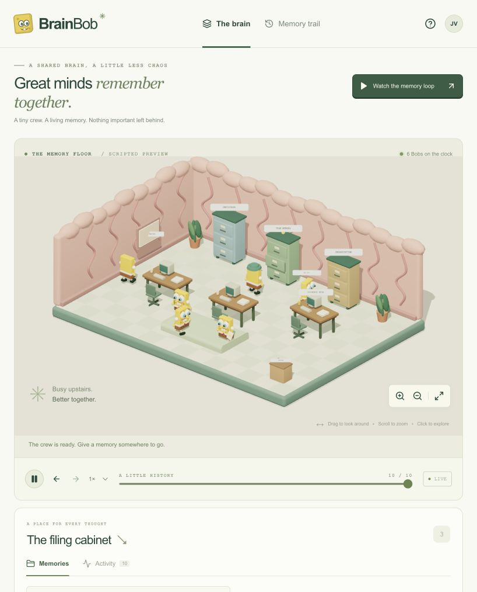

# BrainBob

A shared memory layer that agents read before work and maintain afterward, with memory evaluation and a 3D brain office for inspecting and retracing changes.

Meet the **BrainBobs**: our SpongeBob-inspired memory crew, with round yellow bodies, expressive eyes, lavender overalls, and memory badges.

**Shared Brain** is our primary problem: every agent should read the team's project memory before working and update it afterward. BrainBob aims to keep that knowledge current, lean, and conflict-free. Self-improvement comes from better memory.

The current build is an interactive frontend preview. The 3D room fills the screen, with floating **Chat** and **Memories** panels and a compact demo/retrace dock. Warm sand, cream, and yellow keep the room and characters at the center.



## What Works Today

| Capability | Current implementation |
| --- | --- |
| 3D brain office | Six animated BrainBob workers, desks, filing cabinets, orbit and zoom controls. |
| Floating panels | Chat and memory inspection open over the room. Chat survives closing and reopening its panel. |
| Memory operations | Scripted create, retrieve, check, update, and archive actions with evidence and revision history. |
| Retracing | Project earlier memory states from recorded events; return to the current state without replaying actions. |
| Local persistence | Validated browser-local history, JSON export, and demo reset. |
| Chat controls | A local controller turns supported chat commands into scripted scene events. |

**Still planned:** NemoClaw agents, NVIDIA NeMo Switchyard routing, Crusoe inference, SQL-backed shared memory, role enforcement, conflict handling, and live memory evaluation. The preview makes no model calls and does not yet demonstrate cross-agent memory or measured quality gains.

## Run the Frontend

Requires Node.js 22+ and pnpm 10.32.1.

```bash
pnpm install
pnpm dev
```

Open [the local preview](http://127.0.0.1:3000). No API key is needed for the scripted scene.

- Drag the room to orbit; scroll or use the zoom controls to inspect the crew.
- The 3D room fills the workspace. Open **Chat** or **Memories** as floating panels; close either to return to the room.
- Click a filing cabinet to inspect its memory, or browse individual, team, and organization records in **Memories**.
- Click a memory card to inspect its source evidence and revision history.
- Choose **Run demo** to demonstrate retrieval, evaluation, correction, creation, and archival using fixture data. This restarts the local fixture trace.
- Open **Retrace** and scrub the timeline to follow recorded changes; **Return to live** restores current state.
- Choose **Chat** for scene commands such as “retrieve this memory”. These are scripted commands, not live inference.
- Export the local trace as JSON or reset the scene from the memory panel. History is saved in this browser; it is not yet shared across agents or devices.

```bash
pnpm typecheck
pnpm test
pnpm build
```

The source for this first frontend is in [apps/web](apps/web).

## Architecture and Stack

| Component | Choice | Intended responsibility |
| --- | --- | --- |
| Agent harness | [NVIDIA NemoClaw](https://github.com/NVIDIA/NemoClaw) | Run the agent team inside OpenShell sandboxes. |
| Model routing | [NVIDIA NeMo Switchyard](https://github.com/NVIDIA-NeMo/Switchyard) | Route requests between specialized models from our configured pool. |
| Inference | [Crusoe Managed Inference](https://github.com/crusoecloud/crusoe-developer-hub) | Serve all project model calls, including NVIDIA Nemotron models. |
| Frontend interaction layer | CopilotKit + AG-UI | Present chat, alignment decisions, tool results, and streamed events from the agent backend. |
| 3D visualization | Next.js, React Three Fiber, Three.js, Drei | Isometric brain office, walking BrainBobs, cabinets, and memory retracing. |
| Shared memory | SQLite + versioned Markdown records | Scoped retrieval, evidence, revision history, and transactional updates. |
| Optional planning research | You.com | Retrieve public web sources for planning artifacts. |

The intended agent loop is **read shared memory → work with NemoClaw-managed agents → evaluate and commit memory changes → retrace the evidence**. Switchyard routes specialized model calls to Crusoe. The BrainBob bridge connects agent memory tools to the SQL memory service and emits committed events for the visualization. This combined integration still needs to be built and tested.

See the [architecture and tech stack plan](docs/architecture.md) for the Crusoe memory loop, harness integration, 3D brain, and memory retrace/replay design.

Runtime memories, skills, and plans will be stored as **versioned Markdown documents in SQLite**, with SQL managing scope, evidence, revisions, and relationships. Repository documentation stays in Git and can be imported as reference material.

The proposed Switchyard model pool uses **NVIDIA Nemotron Nano** for bounded memory extraction and **Nemotron Super** for planning, task execution, and memory evaluation on Crusoe. Final route policies require live capability and quality checks. The retrace view will identify the actual route, model, and document revisions behind each decision.

## The Brain We're Building

When memories become stale, instructions conflict, and everyone acts on different context, the brain looks like this:


Our goal is a coordinated team that shares context, organizes memories, and continually checks its work:


BrainBobs are inspired by SpongeBob and the brain-office scenes above. Our characters have round yellow bodies and expressive eyes, with lavender overalls, memory badges, and rosy cheeks and tiny smiles. The supplied images are inspiration references, not screenshots of BrainBob.

## Planned: Planning and Human Alignment

Before agents act, a planning component turns the user's goal into a proposed plan and definition of success.

- Produce **HTML artifacts** that make the goal, assumptions, plan, and acceptance checks easy to inspect.
- Provide a **human-in-the-loop (HITL)** component for reviewing the plan, correcting assumptions, and resolving decisions that need human input.
- Feed those corrections back into the plan and, when appropriate, scoped memory.
- Keep the current alignment artifact available as the team works so agents can check their actions against the agreed goal.
- Optionally use **You.com web search** as a planner tool to research public information and attach source links to the HTML alignment artifact. Planning works without it; Crusoe remains the inference backend.

## Shared Memory Loop

Self-improvement is the secondary outcome: the team performs better as its shared memory becomes more accurate and useful. The hackathon build prioritizes memory management and evaluation; standalone skill learning is a later extension.

1. **Read before work:** Retrieve the relevant shared project context within the agent's permitted scope.
2. **Work with that context:** Record the exact memory revisions supplied to the agent.
3. **Update after work:** Propose new facts, corrections, and retirement of obsolete records with evidence.
4. **Resolve conflicts:** Validate sources and expected revisions before committing changes; keep unresolved conflicts out of ordinary retrieval.
5. **Evaluate:** Check accuracy and usefulness, then compare task outcomes with a baseline agent team.
6. **Retrace:** Show the source conversation, change, evaluation, and subsequent use in the 3D brain and timeline.

### Memory Management

Agents should be able to:

| Operation | Intended behavior |
| --- | --- |
| Create | Save useful facts, preferences, decisions, and project context with supporting evidence. |
| Update | Revise a memory when new evidence changes what is true, preserving the reason for the revision. |
| Forget | Remove obsolete, incorrect, redundant, or no-longer-useful memories from active retrieval. |
| Read | Retrieve relevant memories within the agent's permitted role and scope. |

Memory reads have three scopes:

- **Individual:** Context belonging to a particular user or agent.
- **Team:** Shared context available to authorized members of a team.
- **Organization:** Shared context available to authorized roles across the organization.

Scope and role determine access. An organization-level role does not automatically make every individual's private memory readable. Memory updates and evaluation must respect the same access boundaries as retrieval.

### Memory Evaluation — The Critical Part

Saving a memory is only useful if it remains accurate. The central evaluation loop checks stored memories against a **random sample drawn from the latest 50 conversations** available within the relevant scope.

Planned evaluation flow:

1. Collect the latest 50 eligible conversations, or all available conversations if fewer exist.
2. Draw a random sample and record which conversations were selected so the check can be reproduced.
3. Compare relevant stored memories against the sampled conversation evidence.
4. Classify each checked memory as supported, contradicted, or lacking enough evidence.
5. Keep supported memories, propose updates for changed facts, and forget memories when evidence justifies removal.
6. Record the evidence, decision, and resulting change for inspection.

**Absence from a sample is not proof that a memory is false.** A memory without enough evidence remains unresolved; it should not be deleted simply because it was not mentioned recently. Evaluation must also consider the order of evidence so an old statement does not override an explicit later correction.

The initial proposal samples **10 of the latest 50 eligible conversations** after every five completed task runs, with manual audits also available. Explicit corrections get an immediate targeted check. These are configurable proposed settings; the recent-conversation window is **50 conversations**, not 50 messages.

## The 3D Brain Experience

The scene uses **Three.js**, rendered through **React Three Fiber** in a **Next.js / React** app. **Drei** provides orbit controls, rounded geometry, and billboard labels.

- **Isometric view:** An orthographic camera with a responsive fit, orbit, zoom, and reset.
- **Procedural characters:** BrainBobs are assembled from 3D meshes in code, with articulated arms and legs, soft rounded bodies, lavender overalls, and memory badges.
- **Animation:** React Three Fiber's frame loop moves workers along waypoint routes and animates their limbs. Pause and reduced-motion preferences are respected.
- **Current event feedback:** Scripted memory events change cabinet indicators and worker callouts. Walking routes are ambient animation; they do not represent completed backend tasks.
- **Inspection:** Click a cabinet to open a floating memory inspector. Evidence and history stay available while the room remains visible.
- **Retracing:** The timeline reconstructs recorded memory state; it does not rewind the characters' physical positions or rerun inference.

Scene implementation: [brain-scene.tsx](apps/web/src/components/brain/brain-scene.tsx), [brain-bob.tsx](apps/web/src/components/brain/brain-bob.tsx), and [brain-workspace.tsx](apps/web/src/components/brain-workspace.tsx).

The planned live integration will connect committed memory operations to these visual actions:

| System event | Planned visual |
| --- | --- |
| Planning and alignment | Workers gather around a plan; the HTML alignment artifact opens for review. |
| Memory creation | A worker writes a record and files it in the appropriate cabinet. |
| Memory retrieval | A worker finds a record and delivers it to the agent doing the task. |
| Memory update | A worker replaces an outdated record with a corrected version. |
| Memory forgetting | A worker removes a retired record from the active cabinet. |
| Memory evaluation | An inspector checks records against sampled conversation evidence. |
| Contradiction detected | A confused worker flags conflicting records for resolution. |

The target demonstration is a working shared-memory system with measured evaluation results, made inspectable through the brain animation.

Click a memory to inspect its evidence and revisions. Scrub the timeline to retrace its history without repeating tool calls or inference. Individual workers represent the task agent, memory curator, and evaluator.

## Planned Demo

1. Give the team a goal and review its proposed plan through an HTML alignment artifact.
2. Have one agent complete a task and write useful project memories.
3. Introduce a correction in a later conversation so an existing memory becomes stale.
4. Show the memory evaluator sampling from the latest 50 conversations and inspecting the supporting evidence. Use a recorded sample containing the correction for a reproducible demo, and report when a sample misses it.
5. Watch the brain workers update the stale memory, then show the agent using the corrected fact on a subsequent task.
6. Start a fresh agent and show it completing a held-out task using the maintained shared memory.

Compare the same agent/model configuration with and without maintained shared memory. Measure task correctness, stale-fact usage, repeated context requests, and token usage when available. Include unchanged valid memories and conflicting sources so the evaluator cannot score well just by rewriting everything. These are planned measurements; no results are available yet.

## Hackathon Alignment

Built for **The Recursive Agents Hackathon**, October 17, 2026, with **Crusoe Managed Inference** as the planned inference backend.

- **Primary fit — Shared Brain:** Shared, scoped memory that agents read and maintain, with evaluation of accuracy and output quality.
- **Secondary outcome — self-improvement:** Demonstrate that maintained memory helps new agents produce better results on tasks they have not seen.
- **Supporting behavior — Done Means Done:** Plans, explicit success checks, and human alignment before execution.

## Project Documents

| Document | Contents |
| --- | --- |
| [Architecture](docs/architecture.md) | Harness integration, SQL-backed Markdown, model routing, and event design. |
| [Memory benchmarks](docs/benchmarks.md) | Proposed experiments, baselines, metrics, and evaluation targets. |
| [Competition details](docs/competition-details.md) | Participant-guide problem statements, rules, schedule, and submission requirements. |
| [Judging guide](judging/README.md) | Entry point for reviewers. |
| [Demo runbook](judging/demo-runbook.md) | Intended presentation flow. |
| [Evidence sheet](judging/evidence.md) | Integration evidence and measured results to record before submission. |
| [Proof-of-work timeline](judging/proof-of-work/index.html) | Build milestones and screenshots; open the HTML file in a browser. |

Benchmark targets and planned demo steps are proposals. Verified results belong in the evidence sheet.
