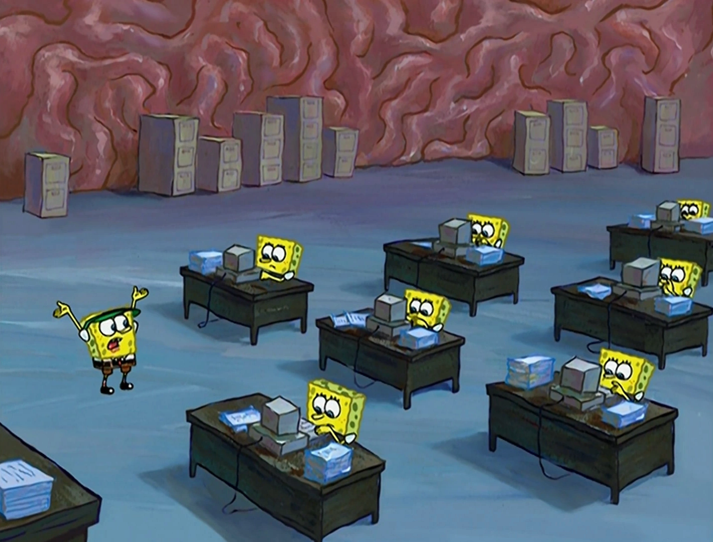

# Brain Bob

An agent team that manages what it knows, learns how to work better, and checks whether its memories and skills still hold up.

Think of the SpongeBobs working inside a brain: some plan, some file memories, some retrieve information, and others check that the filing cabinets still contain the truth. We're bringing that metaphor to life with a fun 3D animation connected to the agents' actual work.

**Status:** Hackathon concept and planned behavior. The agent system, evaluations, and 3D experience have not yet been implemented.

See the [architecture and tech stack plan](docs/architecture.md) for the Crusoe memory loop, CopilotKit/AG-UI integration, 3D brain, and memory retrace/replay design.

## The Brain We're Building

When memories become stale, instructions conflict, and everyone acts on different context, the brain looks like this:

Our goal is a coordinated team that organizes memories, learns useful procedures, and continually checks its work:

These supplied images are visual references for the planned animation.

## Planning and Human Alignment

Before agents act, a planning component turns the user's goal into a proposed plan and definition of success.

- Produce **HTML artifacts** that make the goal, assumptions, plan, and acceptance checks easy to inspect.
- Provide a **human-in-the-loop (HITL)** component for reviewing the plan, correcting assumptions, and resolving decisions that need human input.
- Feed those corrections back into the plan and, when appropriate, scoped memory.
- Keep the current alignment artifact available as the team works so agents can check their actions against the agreed goal.
- Optionally use **You.com web search** as a planner tool to research public information and attach source links to the HTML alignment artifact. Planning works without it; Crusoe remains the inference backend.

## Self-Improvement

The system improves through two connected loops: **memory**, which captures what agents know, and **skills**, which capture how agents do things.

### Memory Management

Agents should be able to:

| Operation | Intended behavior |
| --- | --- |
| Create | Save useful facts, preferences, decisions, and project context with supporting evidence. |
| Update | Revise a memory when new evidence changes what is true, preserving the reason for the revision. |
| Forget | Remove obsolete, incorrect, redundant, or no-longer-useful memories from active retrieval. |
| Read | Retrieve relevant memories within the agent's permitted role and scope. |

Memory reads have three scopes:

- **Individual:** Context belonging to a particular user or agent.
- **Team:** Shared context available to authorized members of a team.
- **Organization:** Shared context available to authorized roles across the organization.

Scope and role determine access. An organization-level role does not automatically make every individual's private memory readable. Memory updates and evaluation must respect the same access boundaries as retrieval.

### Memory Evaluation — The Critical Part

Saving a memory is only useful if it remains accurate. The central evaluation loop checks stored memories against a **random sample drawn from the latest 50 conversations** available within the relevant scope.

Planned evaluation flow:

1. Collect the latest 50 eligible conversations, or all available conversations if fewer exist.
2. Draw a random sample and record which conversations were selected so the check can be reproduced.
3. Compare relevant stored memories against the sampled conversation evidence.
4. Classify each checked memory as supported, contradicted, or lacking enough evidence.
5. Keep supported memories, propose updates for changed facts, and forget memories when evidence justifies removal.
6. Record the evidence, decision, and resulting change for inspection.

**Absence from a sample is not proof that a memory is false.** A memory without enough evidence remains unresolved; it should not be deleted simply because it was not mentioned recently. Evaluation must also consider the order of evidence so an old statement does not override an explicit later correction.

The sample size and evaluation frequency are implementation choices still to be defined. The recent-conversation window is **50 conversations**, not 50 messages.

### Skill Learning — How-To Knowledge

Skills are reusable procedures agents learn from doing work: instructions, workflows, and approaches that help them complete future tasks.

| Operation | Intended behavior |
| --- | --- |
| Create | Capture a useful procedure discovered while completing a task. |
| Update | Improve an existing procedure based on outcomes and evaluation. |
| Forget | Retire a procedure that is obsolete, harmful, redundant, or consistently unhelpful. |
| Read | Make skills available according to role and individual, team, or organization scope. |

**Skill evaluation** assesses usefulness through task outcomes: did the procedure help the agent complete the task correctly, and did it reduce unnecessary work? Based on that evidence, the system decides whether to retain, improve, or remove the skill.

Proposed skill changes should be compared with the previous version on evaluation tasks. Keep a change when it measurably helps, and retain the previous version when it does not. Include unseen tasks to check whether an improvement transfers beyond the run that produced it.

## The 3D Brain Experience

A playful 3D brain office will show the SpongeBob workers carrying out memory management and skill learning. The animation should reflect actual agent events so viewers can follow what is happening.

| System event | Planned visual |
| --- | --- |
| Planning and alignment | Workers gather around a plan; the HTML alignment artifact opens for review. |
| Memory creation | A worker writes a record and files it in the appropriate cabinet. |
| Memory retrieval | A worker finds a record and delivers it to the agent doing the task. |
| Memory update | A worker replaces an outdated record with a corrected version. |
| Memory forgetting | A worker removes a retired record from the active cabinet. |
| Memory evaluation | An inspector checks records against sampled conversation evidence. |
| Skill learning | A worker writes or revises a how-to manual. |
| Skill evaluation | Workers try a procedure, compare results, and keep, improve, or retire it. |
| Contradiction detected | A confused worker flags conflicting records for resolution. |

The core demonstration is the working agent system and its evaluation loop. The brain animation makes that behavior visible and fun.

## Planned Demo

1. Give the team a goal and review its proposed plan through an HTML alignment artifact.
2. Run a task that creates useful memories and a reusable skill.
3. Introduce a correction in a later conversation so an existing memory becomes stale.
4. Show the memory evaluator sampling from the latest 50 conversations and inspecting the supporting evidence. Use a recorded sample containing the correction for a reproducible demo, and report when a sample misses it.
5. Watch the brain workers update the stale memory, then show the agent using the corrected fact on a subsequent task.
6. Evaluate a learned skill on unseen tasks and show why the system keeps, improves, or removes it.

Evidence we want to show includes memory accuracy before and after evaluation, retrieval of corrected facts, access boundaries between scopes, and task outcomes with and without learned skills. These are planned measurements; no results are available yet.

## Hackathon Alignment

Built for **The Recursive Agents Hackathon**, October 17, 2026, with **Crusoe Managed Inference** as the planned inference backend.

- **Primary fit — Shared Brain:** Shared, scoped memory that agents read and maintain, with evaluation of accuracy and output quality.
- **Secondary fit — Version N+1:** Learned skills that improve through measured outcomes and evaluation on unseen tasks.
- **Supporting behavior — Done Means Done:** Plans, explicit success checks, and human alignment before execution.

See [competition details](docs/competition-details.md) for the official problem statements, rules, schedule, judging criteria, and submission requirements. The README will be updated with setup instructions, demo links, measured results, and an explicit account of work built during the event as implementation progresses.
