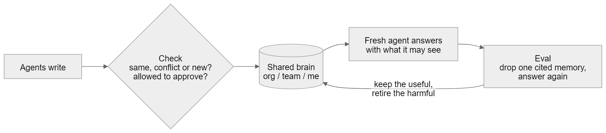
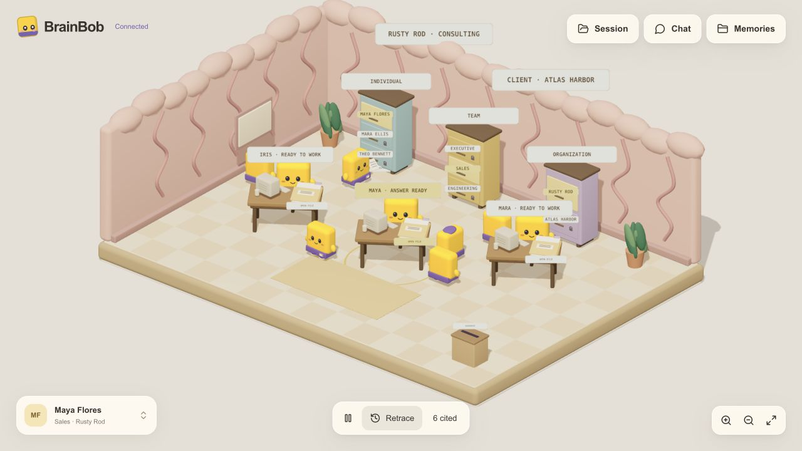

# BrainBob

**A shared brain for agent teams. Keep knowledge current, control who can use it, and trace every change.**

https://github.com/user-attachments/assets/e75a7bcc-b46e-4c95-9e15-6edac63a0b38

**[▶ Watch V2 — 2:50](https://github.com/user-attachments/assets/e75a7bcc-b46e-4c95-9e15-6edac63a0b38)** · Edited live recording with new ElevenLabs narration and fictional company data.

Follow Maya as she changes a personal preference through agent chat, then starts a fresh session that cites the updated memory. The film opens with the problem and solution, explains memory operations and evaluation, presents the benchmark and experimental fine-tuned checker, and closes with the creators and repository.

BrainBob checks new facts against existing knowledge, applies authorized corrections, and gives each agent the context its user may read. A live 3D brain office makes the sources, decisions, and subsequent answers inspectable.

Built by **Jerel Velarde and Bonan Kou** for the **Shared Brain** track at The Recursive Agents Hackathon, October 17, 2026.

[Problem](#the-problem) · [Solution](#the-solution) · [Results](#results) · [Run locally](#run-locally) · [Architecture](docs/architecture.md) · [Published benchmark](https://huggingface.co/datasets/JerelVelarde/bob-benchmark) · [Judging evidence](judging/evidence.md)

## The problem


*The inspiration behind BrainBob’s memory office.*

Agent teams share facts across conversations, people, and tasks. But those facts change: a deadline moves, an estimate becomes an approved commitment, or a teammate's access changes while old notes remain available.

Storing more context leaves several questions unresolved:

- **Stale facts.** An outdated deadline can survive beside its correction and appear in the next answer.
- **Unapproved changes.** A tentative suggestion should not replace an approved client commitment.
- **Private context.** A Sales agent needs shared client decisions without receiving private Engineering discussions.
- **Missing evidence.** A saved claim needs a source, a change history, and a way to inspect how it affected an answer.

Without maintenance, one agent's mistake becomes the next agent's starting point. The challenge is keeping shared knowledge **current, authorized, and traceable** as the team works.

## The solution

**We built three connected deliverables: the BrainBob application, a public benchmark, and a fine-tuned memory checker.**

| What we built | What it does | Results and evidence |
| --- | --- | --- |
| **BrainBob — shared-memory service and 3D agent workspace** | Checks new facts, applies authorized corrections, retrieves scoped context, and exposes sources and revision history through live chat. | **12/13 correct memory updates vs 0/13 with append-only**, with **0/32 valid memories wrongly retired** in the Rusty Rod suite. [Live demo evidence](judging/live-workspace-20261017/README.md) · [Measured results](docs/evaluation-report.md#experiment-5-rusty-rod-correctness-suite-synthetic-held-out) |
| **[Bob Benchmark — our public evaluation dataset and harness](https://huggingface.co/datasets/JerelVelarde/bob-benchmark)** | We created six synthetic organizational worlds with **41 checkpoints**, a runner, deterministic scorer, baselines, and separate memory-relation diagnostics. | BrainBob scored **71.9% macro CATS vs 25.0% without memory** across three replicates, using corrected v0.3 scoring. The advantage over append-only is inconclusive; full authorized history scored 92.0%. [Scorecard and traces](bobbench/results/20261017-141014/) |
| **[Fine-tuned Qwen3-0.6B memory checker — our LoRA adapter](https://huggingface.co/Guangze/memops-small-qwen3-0.6b-lora/tree/b904e6ec0baea37bf70209093b8c59332d3c450a)** | We trained and published a small model to classify candidate facts as **same, conflict, or unrelated** before deterministic memory policy decides the action. | **32/60 → 42/60 correct** versus the untuned base: **+16.7 percentage points** on the original synthetic pair diagnostic. Five false conflicts keep it **experimental and opt-in**; the production judge is unchanged. [Training and evaluation report](docs/evaluation-report.md#experiment-7-small-memory-relation-checker-issue-7-pair-diagnostic) |

These results come from separate evaluations. Public synthetic diagnostics are not official leaderboard scores; the [results below](#results) retain uncertainty, scorer corrections, and limitations.



**Check before writing, verify after use.** [Editable diagram source](diagrams/memory-simple.mmd).

1. **Check incoming knowledge.** Extract facts from source conversations. Compare each candidate with existing memories: same, conflict, or unrelated. Apply authority, scope, date, and lock rules before changing what is current.
2. **Share the right context.** Retrieve relevant individual, team, and organization memories for the requesting member. An agent can cite the records it used; retired facts remain in history rather than ordinary retrieval.
3. **Evaluate and retrace.** Check source support and task usefulness separately. The usefulness evaluator removes a cited memory, answers again, and compares task grades. Ordinary harmful-memory retirement requires confirming evidence; the office exposes recorded operations, sources, and history.

For example, a tentative Engineering estimate should not replace an approved client commitment. When an authorized correction changes November 6 to November 13, the next Sales agent should use November 13 with supporting citations. Our [recorded live workspace](judging/live-workspace-20261017/README.md) demonstrates that sequence using fictional company data and real Crusoe inference.



*Recorded live workspace at build `489919b`; [capture provenance](judging/live-workspace-20261017/captures.json). This is a development demonstration, separate from the benchmark results below.*

## Results

**On our six-world organizational pilot, maintained BrainBob memory scored 71.9% macro CATS versus 25.0% with no memory: +46.9 percentage points, 95% interval [22.7, 71.1].** Maintenance's advantage over append-only memory remains inconclusive.

### Organizational memory pilot

Six synthetic worlds, 41 checkpoints, three replicates per condition. Every condition uses the same answering model and prompt: Nemotron-3.5-Lightning at temperature 0. Results use **scorer/oracle v0.3**, a post-hoc correction applied to the original saved answers without new model calls.

| Condition | Macro CATS | Role in the comparison |
| --- | ---: | --- |
| No memory | 25.0% | Answers without stored context |
| Append-only memory | 67.9% | Stores facts without write-time maintenance |
| **Maintained BrainBob memory** | **71.9%** | Checks and maintains stored facts |
| Full authorized history | 92.0% | Supplies all readable source events; these small worlds fit in context |
| Always refuse | 25.0% | Control showing that refusal alone earns some points |
| Unfiltered history | 6.5% | Control that exposes protected context |

CATS is an all-checks-pass score, not ordinary answer accuracy: a checkpoint must satisfy its required-fact, stale-claim, response-behavior, protected-content, citation, and execution checks. Replicates are averaged, then worlds and the three task sections are equally weighted. The grader uses deterministic checks and retains documented limitations.

- **Maintained vs append-only:** +4.0 points, 95% interval **[−9.0, 18.2]**. This does not establish a maintenance advantage.
- **Protected-content disclosures:** **0/111 applicable answer/context records** for maintained memory; the unfiltered control disclosed in **111/111**. These are protected-string checks on this pilot, not a general security guarantee.
- **Version history:** the original v0.2 result was 74.4%. Both scorecards remain available; v0.3 corrects known scoring/oracle errors after results were inspected.

[Corrected scorecard](bobbench/results/20261017-141014/scorecard.v0.3.md) · [Original scorecard and traces](bobbench/results/20261017-141014/) · [Full evaluation report](docs/evaluation-report.md#experiment-6-bob-organizational-pilot-proposed-benchmark-synthetic) · [Metric derivation and worked example](https://github.com/jerelvelarde/BrainBob/blob/373eee2e11891e43232ae509c1d7de9ae3567e3a/docs/bob-metrics-explained.md)

### Supporting experiments

| Experiment | Observed result | Interpretation |
| --- | --- | --- |
| Rusty Rod correctness: 30 held-out synthetic scenarios, 76 questions | **12/13** correct state updates vs **0/13** append-only; **0/32** valid memories wrongly retired. Answer accuracy **68/76 vs 67/76**. | Maintenance improved memory state; the answer-quality difference was not significant. |
| LoCoMo: 760 held-out questions | **404/760** with memory vs **85/760** without. Audited memory also scored **404/760**. | Retrieved context helped; the audit added no measured gain. |
| LongMemEval: modified 50-question subset | Answer context **2,681 vs 108,946 tokens**; accuracy **35/50 vs 39/50** for full history. | About 40× less answer context, with lower observed accuracy; not total pipeline savings. |
| BANKING77: 300 held-out tasks | Ordinary and audited memory both **202/300**; audit difference **0.0 points [−1.3, 1.3]**. | A null result for the frozen usefulness-audit policy. |
| Small memory checker: 60 synthetic pairs | Qwen3-0.6B base **32/60 → 42/60** with LoRA; **+16.7 points [5.0, 28.3]**. | Better relation classification on this diagnostic, with five false conflicts; experimental and opt-in. |

These experiments measure different capabilities and should not be averaged. The public subsets and modified protocols are not official leaderboard results. [Methods, model settings, artifacts, and limitations](docs/evaluation-report.md).

## What you can use today

- **Live agent workspace:** three independent desk conversations, CopilotKit chat, suggested actions, and returned session context.
- **Memory overview:** full-screen chat has a Summary tab powered by a dedicated NVIDIA Nemotron Nano model on Crusoe, plus Memory files for original records and source history.
- **Scoped memory:** source ingestion, BM25 retrieval, approved corrections, tentative conflicts, owner locks, and retirement.
- **Inspectable operations:** source/model details, citations, persisted HTTP/SSE events, and read-only retracing.
- **Reproducible evidence:** published synthetic benchmark, saved predictions, versioned scorecards, and recorded live-app checks.

The [Bob benchmark](https://huggingface.co/datasets/JerelVelarde/bob-benchmark) covers changing facts, organizational permissions, and agent handoffs. The organizational pilot in `bobbench/` is distinct from the smaller memory-pair and structured diagnostics in `benchmarks/bob/`. Oracle labels are public evaluation assets and must stay outside tested agents' inputs and training data; this is not an independently secret test set.

Bonan's [Qwen3-0.6B LoRA checker](https://huggingface.co/Guangze/memops-small-qwen3-0.6b-lora/tree/b904e6ec0baea37bf70209093b8c59332d3c450a) classifies **same / conflict / unrelated**. The production gpt-oss checker remains the default. The original 60 cases have now been inspected and are development data for further tuning. A separate one-replicate maintenance-judge comparison found no statistically resolved advantage for the tuned checker; see [Experiments 7 and 8](docs/evaluation-report.md#experiment-7-small-memory-relation-checker-issue-7-pair-diagnostic).

## Run locally

Requires **Node.js 22+**, **pnpm 10.32.1**, **Python 3.12**, and **uv**. Run from the repository root:

```sh
pnpm install
uv venv --python 3.12 backend/.venv
uv pip install --python backend/.venv/bin/python -r backend/requirements.txt
```

Save a Crusoe API key privately at `~/.config/crusoe/api.key` with mode `0600`, or set `BRAINBOB_API_KEY` in the backend environment. Keep it out of Git and browser environment variables. Startup checks, source ingestion, chat, and memory summaries make real provider calls; identical summary inputs can reuse the model cache.

```sh
# Terminal 1: verify provider access and start the backend on port 3001
pnpm backend

# Terminal 2: import fictional source conversations, then start the app
pnpm seed:company
pnpm dev
```

Open **[http://127.0.0.1:3000](http://127.0.0.1:3000)**. Select a desk, ask for a draft, and open **Memory**. **Summary** gives an overview of current accessible memory; **Memory files** shows saved records or the sources used in a reply. Open a source for its history, or use Retrace to follow a correction. [Summary setup and behavior](docs/live-workspace.md#memory-summary-and-files). `/demo`, `/rehearsal`, and `/character-study` redirect to this workspace.

The importer covers **29 fictional conversations, 18 people, and 22 scopes**. Repeating it skips previously imported sources. Memory and events persist under ignored `data/workspace/`; desk conversations and returned session files remain browser-local. [Full setup and behavior](docs/live-workspace.md) · [Proxy configuration and offline smoke check](apps/web/README.md).

```sh
# Frontend checks, from the repository root
pnpm typecheck
pnpm test
pnpm build

# Deterministic backend checks
(cd backend && .venv/bin/python -m pytest tests -q)
```

## Current architecture

| Layer | Implementation |
| --- | --- |
| App | Next.js, React, CopilotKit + AG-UI, React Three Fiber / Three.js / Drei |
| Service | Python / FastAPI; same-origin Next proxy for HTTP and SSE |
| Memory | JSONL records and events, BM25 retrieval, scope checks, source and supersession links |
| Live-app extraction / answering | NVIDIA Nemotron Nano / Nemotron Super on Crusoe |
| Memory summarization | Dedicated NVIDIA Nemotron Nano 30B-A3B role on Crusoe; read-only |
| Default maintenance and audit judge | `openai/gpt-oss-120b` on Crusoe |
| Evaluation | Separate source-support audit, task-usefulness evaluator, and benchmark scorers |
| Optional NemoClaw/OpenClaw adapter | Scoped memory tools and MCP server implemented; sandbox integration and end-to-end validation pending |

The application launcher overrides the backend's default Lightning model assignments; benchmark runs retain their recorded settings. [Component diagram, data flow, and model assignments](docs/architecture.md).

The member selector is a development identity marker, **not production authentication**. Retirement preserves history; it is not erasure. Usefulness evaluation requires task grades and is not automatically run on every chat.

The [NemoClaw/OpenClaw adapter](integrations/nemoclaw/README.md) exposes `read_memory`, `read_source`, and `propose_memory` with a host-bound member and discussion-only proposals. **The adapter is implemented; sandbox integration and end-to-end validation are pending.** Its ten fake-backend unit tests do not establish a live harness run. The verified app continues to use the direct Python/Crusoe path.

Switchyard, SQL storage, and planner alignment remain roadmap work. GateMem, MUMBench, and CoMemBench have no reported BrainBob scores.

## Team and evidence

**Jerel Velarde:** app, interaction design, visualization, and independent evaluation presentation. **Bonan Kou:** agents, shared memory, maintenance/evaluation backend, and the smaller-checker experiment.

| Document | Start here for |
| --- | --- |
| [Architecture](docs/architecture.md) | Implemented components and boundaries |
| [Evaluation report](docs/evaluation-report.md) | All experiments, corrected scores, and limitations |
| [Judging guide](judging/README.md) | Reviewer reading path |
| [Evidence sheet](judging/evidence.md) | Recorded outcomes and remaining submission fields |
| [Live-workspace verification](judging/live-workspace-20261017/README.md) | Real-provider development demo and access checks |
| [Memory-summary verification](judging/memory-summary-20261017/README.md) | Live Nano inference, tab behavior, and desktop/mobile evidence |
| [Proof of work](judging/proof-of-work/index.html) | Commit-linked build milestones and screenshots |
