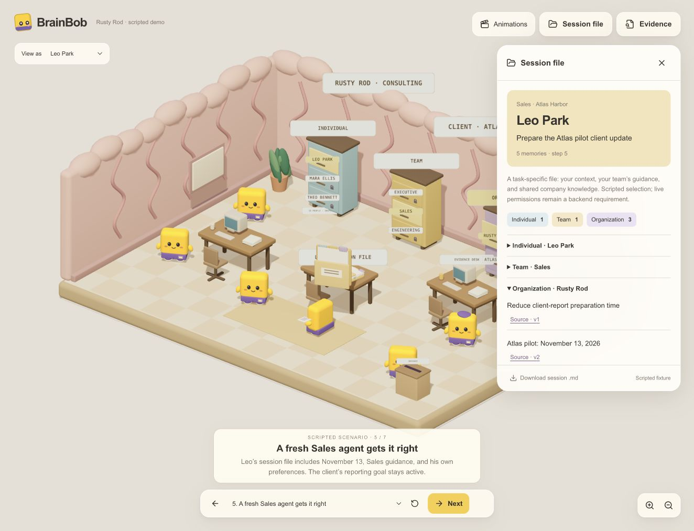

# BrainBob

**A shared brain that helps agent teams keep the right knowledge current—and makes every memory change inspectable.**

An agent can finish its task and leave behind a wrong fact. The next agent inherits it, repeats it, and spreads the mistake. BrainBob combines scoped memory, evidence-backed maintenance, and evaluation so teams can inspect what agents remember, why it changed, and what a fresh agent actually uses.

Built by **Jerel Velarde and Bonan Kou** for the **Shared Brain** track at The Recursive Agents Hackathon, October 17, 2026. Model calls run through **Crusoe Managed Inference**.

> **Hackathon build in progress.** The memory backend, evaluation experiments, and interactive app are implemented. Jerel is completing the end-to-end app experience. Bonan's [0.6B fine-tuned memory checker](https://huggingface.co/Guangze/memops-small-qwen3-0.6b-lora) is published with synthetic diagnostic results; it remains experimental and opt-in. Final integrated submission verification is pending.



*Captured from the scripted Rusty Rod walkthrough. It illustrates individual, team, and organization context; it is not evidence of live inference. [Capture provenance](judging/proof-of-work/screenshots/tier-session-captures.json).*

## The Shared Brain loop

1. **Read:** give an agent the relevant context within its permitted scope.
2. **Work:** answer with citations to the memories it used.
3. **Maintain:** extract new facts, distinguish tentative discussion from approved changes, and preserve correction history.
4. **Evaluate:** check source support separately from whether a memory helps a task.
5. **Retrace:** inspect the source, decision, memory revision, and subsequent use in the 3D office.

The demo company, **Rusty Rod**, has 18 members across Executive, Sales, and Engineering. The three cabinet tiers represent individual, team, and organization memory. A Sales agent should use its own preferences, Sales guidance, and an approved client commitment without receiving private Engineering discussions. A tentative estimate should not overwrite an approved commitment; an authorized correction should reach the next agent.

## What is built, and what is next

| Area | Current state |
| --- | --- |
| Shared memory backend | Python service with extraction, BM25 retrieval, scope checks, immutable correction records, retirement, owner locks, and persisted JSONL memory/events. |
| Correctness maintenance | Write-time comparison plus deterministic authority/date/scope rules; a recent-conversation audit records sampled evidence and verdicts. |
| Usefulness evaluation | Remove a cited memory, re-answer, and compare task grades. Harmful memories require confirmation before ordinary evaluator retirement. |
| Interactive app | Next.js 3D office, CopilotKit chat, HTTP/SSE integration, source inspection, tiered memory views, and event retracing. Final live integration is in progress. |
| Evaluation evidence | Published conversational benchmarks, the synthetic Rusty Rod correctness run, and two recorded backend demo runs. |
| Bob Benchmark | Six organizational pilot worlds and oracle labels on `main`; an executable diagnostic pilot and small-model evaluation handoff are tracked in [PR #9](https://github.com/jerelvelarde/BrainBob/pull/9). |
| Smaller checker | Published [Qwen3-0.6B LoRA adapter](https://huggingface.co/Guangze/memops-small-qwen3-0.6b-lora): reported 32/60 base → 42/60 tuned on public synthetic checker pairs. Integration and promotion checks remain tracked in [#7](https://github.com/jerelvelarde/BrainBob/issues/7). |

The recorded backend demo uses legacy identities and disables organization permissions/write-time maintenance. It is a verified **usefulness** demonstration, not proof of the complete organizational app flow. Jerel is connecting that experience to the current app; see the [integration boundary](docs/frontend-integration.md).

## Correctness and usefulness are different

**Correctness:** Is the fact supported, current, and authorized? The maintenance layer compares candidate facts with existing records, then applies code-level rules for authority, scope, timing, and locks. Missing evidence does not justify forgetting a valid memory.

**Usefulness:** Did including this memory change whether an answer was correct? The evaluator compares answers with and without a cited memory. A useful memory is not necessarily true, and an unhelpful memory is not necessarily false.

The smaller-model experiment targets the bounded semantic decision **`same` / `conflict` / `unrelated`** through the existing maintenance hook. Code retains control of permissions and mutations. The experiment does not train company facts into model weights or replace the independent evaluation scorer. Until validated, the existing checker remains the default.

## Evidence so far

Results below describe specific runs, not general accuracy guarantees. Full setup, limitations, and artifacts are in the [evaluation report](docs/evaluation-report.md).

| Experiment | Observed result | What it establishes |
| --- | --- | --- |
| Rusty Rod correctness: 30 synthetic scenarios, 76 questions | Maintained memory: **12/13 correct state updates**, **0/32 valid memories wrongly retired**. Answer accuracy: **68/76**, versus append-only **67/76** and full history **73/76**. | Evidence of state maintenance; no demonstrated answer-quality advantage over full history. |
| LoCoMo: 760 held-out questions | No memory **85/760**; ordinary and audited memory both **404/760**. | Retrieved memory helps this task; the audit adds no measured gain. |
| LongMemEval: 50-question subset | Answer context **2,681 vs 108,946 tokens**; extracted-memory accuracy **35/50** versus full history **39/50**. | A context-size tradeoff, not accuracy parity or total pipeline savings. |
| BANKING77: 300 held-out tasks | Ordinary and audited memory both **202/300**; paired audit difference **0.0 percentage points**, 95% interval **[-1.3, +1.3]**. | A null result for the frozen usefulness-audit policy. |
| Small-checker Bob diagnostic: 60 public synthetic pairs | Published base → tuned accuracy: **32/60 → 42/60** (53.3% → 70.0%); macro-F1 **0.437 → 0.694**; **0 invalid outputs** for both. | A measured semantic-classification gain on this pilot, with false-conflict risk; not end-to-end memory safety or independent benchmark validation. |

In the Rusty Rod run, the recent audit changed no answers beyond write-time maintenance. Its short scenarios fit entirely inside the sampling window, and its scored judgments were overwhelmingly supported examples. It does not establish robust contradiction detection or performance when sampling misses decisive evidence. Scope leakage there measures filtered retrieval, not complete application security. The report also documents coarse string-grading errors.

## Bob (Shared Brain) Benchmark

Bob evaluates organizational memory through changing facts, permissions, and agent handoffs. The current [pilot data](bobbench/worlds/README.md) contains **six synthetic worlds, 175 timeline items, and 41 checkpoints** covering:

- Individual/team/organization context assembly and authorized corrections.
- Cross-organization publication, membership changes, grant expiry, and revocation.
- Conflicting evidence, retention of valid knowledge, and correction propagation between agents and summaries.

Source events and oracle labels are separate. The Atlas walkthrough is explicitly public development data. Oracle files are public evaluation assets that must stay outside the tested model's inputs and training data; they are not an independently secret test set. Labels have not received independent human adjudication.

The [executable diagnostic pilot in PR #9](https://github.com/jerelvelarde/BrainBob/pull/9) is a separate, smaller slice: 60 balanced checker pairs plus 12 development pairs, and reference controls over 18 workflow checkpoints. Reference-control scores validate the harness; they are not BrainBob or fine-tuned-model results. The published checker predictions below are a separate real-model run; an integrated real-system comparison remains pending.

Bob is a **proposed public benchmark**, informed by GateMem, MUMBench, CoMemBench, and other prior work documented in the [specification](docs/bob-benchmark-spec.md). These pilots are not official results on those external benchmarks.

## Published small memory checker

Bonan's [memops-small Qwen3-0.6B LoRA](https://huggingface.co/Guangze/memops-small-qwen3-0.6b-lora/tree/8f832dbfecddc028d130c0eee321111f4e34404c) classifies candidate/existing fact pairs as strict JSON `same`, `conflict`, or `unrelated`. It was trained on 144 synthetic pairs for one epoch on an NVIDIA L4. The release includes adapter weights, training code, provenance, and base/tuned predictions. Its [run metadata](https://huggingface.co/Guangze/memops-small-qwen3-0.6b-lora/blob/8f832dbfecddc028d130c0eee321111f4e34404c/runs/20261017-210457/run_meta.json) records a saved-adapter reload check matching three tuned predictions.

The [model card](https://huggingface.co/Guangze/memops-small-qwen3-0.6b-lora/blob/8f832dbfecddc028d130c0eee321111f4e34404c/README.md) reports a **+16.7 percentage-point accuracy gain**, but also **five non-conflict pairs mislabeled as conflict** (base: zero), and half of true conflicts still missed as unrelated. These 60 public, single-annotator synthetic pairs have no independent label review or same-set large-judge comparison yet. The result supports further testing, not automatic promotion. Deterministic policy retains control of memory changes; the existing checker remains the default.

## Run locally

### App

Requires Node.js 22+ and pnpm 10.32.1.

```bash
pnpm install
pnpm dev
```

- [Live workspace](http://127.0.0.1:3000/): requires the backend below.
- [Scripted walkthrough](http://127.0.0.1:3000/demo): works without an API key; synthetic context and answers are labeled.
- [Animation rehearsal](http://127.0.0.1:3000/rehearsal): inspect the visual language independently of inference.

### Backend

Requires Python 3.12 and `uv`. The current client reads a Crusoe API key from `~/.config/crusoe/api.key`; create that file privately and keep credentials out of Git and browser configuration.

```bash
cd backend
uv venv --python 3.12
uv pip install --python .venv/bin/python fastapi uvicorn sse-starlette httpx pytest openai rank-bm25 pyarrow huggingface_hub
.venv/bin/python server.py
```

These commands use macOS/Linux paths; on Windows use `.venv/Scripts/python.exe`. The server listens on `127.0.0.1:3001` and defaults to Rusty Rod organization mode. Memory, episode, and event files persist in its working directory. Use `NEXT_PUBLIC_BRAINBOB_API_URL` for a different backend URL; configure CORS for that origin. See the [connection guide](docs/frontend-integration.md) and [backend contract](backend/CONTRACT.md).

### Checks and experiments

```bash
# Repository root: frontend checks
pnpm typecheck
pnpm test
pnpm build

# From backend/: deterministic backend tests
.venv/bin/python -m pytest tests -q

# From backend/: development-only correctness smoke run; makes model calls
.venv/bin/python bench.py correctness --split dev --fast
```

Use [recorded results](docs/evaluation-report.md) for existing scores. Keep development examples separate from a frozen evaluation set. The [backend demo runbook](backend/demo/DEMO.md) documents reset, seeded history, live calls, and the recorded fallback.

## Current architecture

| Component | Implementation |
| --- | --- |
| App | Next.js, React Three Fiber / Three.js / Drei, CopilotKit + AG-UI |
| Service and events | Python, FastAPI, HTTP requests and server-sent events |
| Memory | JSONL persistence, BM25 retrieval, source IDs, supersession links, event history |
| Extraction and default answering | `nvidia/Nemotron-3.5-Lightning-30B-A3B` on Crusoe |
| Current maintenance/audit checker | `openai/gpt-oss-120b` on Crusoe |
| Experimental checker | Published Qwen3-0.6B LoRA semantic-relation classifier; opt-in, not the current default |

NemoClaw, Switchyard, and SQL storage appear in earlier architecture plans but are not integrated into this build. Model roles and experimental overrides are recorded in the evaluation artifacts.

The member selector supplies a **demo identity**, not authentication. Retired records remain in history; retirement is not erasure. Screenshots and replay demonstrate inspectability, while live traces and evaluation runs establish execution and measured behavior.

## Team and submission

- **Jerel Velarde** — end-to-end app, interaction design, visualization, and independent evaluation presentation.
- **Bonan Kou** — agents, shared memory, maintenance/evaluation backend, and the smaller-checker experiment.

Final P0 work: verify the connected organizational app flow, independently rescore the published checker predictions and check its integration/policy behavior, reconcile the benchmark/run artifacts, and complete the demo/video/submission links. Report the accuracy gain alongside false-conflict risk; the working default checker remains available.

[Judging guide](judging/README.md) · [Evidence sheet](judging/evidence.md) · [Proof of work](judging/proof-of-work/index.html) · [Competition details](docs/competition-details.md)
