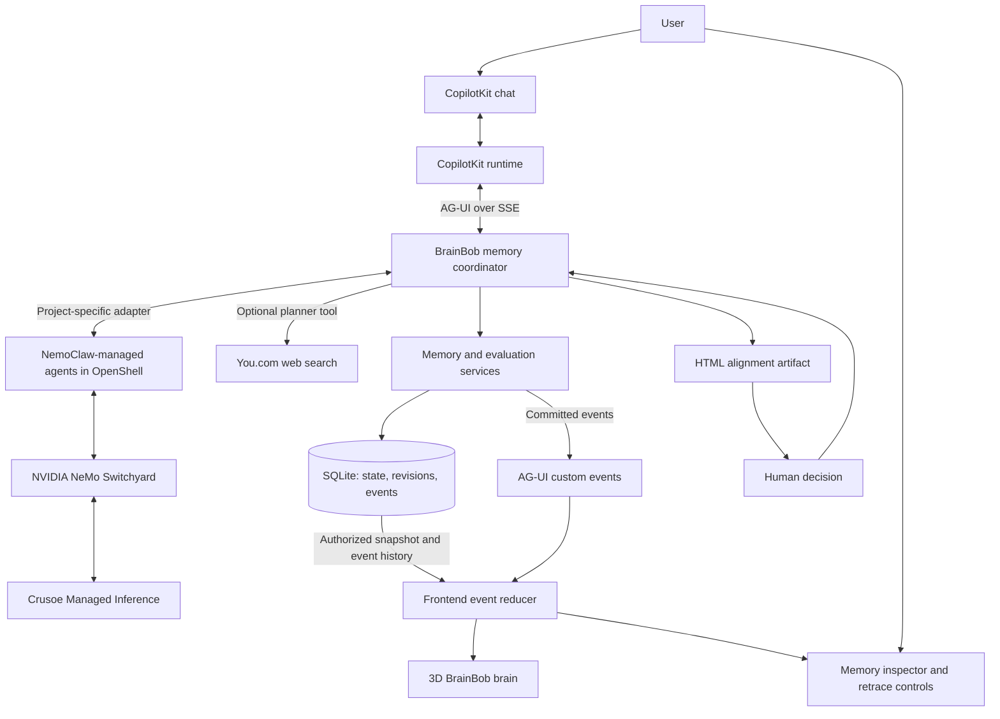

> **Historical proposal — superseded.** Preserved from the initial October 17 design. This document includes unimplemented technologies and scripted-preview behavior. Read [the current architecture](architecture.md) for the working build.

# BrainBob — Architecture and Tech Stack

Implementation plan for the Recursive Agents Hackathon, October 17, 2026. The first 3D frontend is implemented; backend sections describe intended integrations.

**Current decisions:** Shared Brain is the primary problem statement. Use NVIDIA NemoClaw for the agent harness, NVIDIA NeMo Switchyard for model routing, and Crusoe Managed Inference for inference. Self-improvement is demonstrated through better shared memory; independent skill learning is deferred. The initial frontend is a clearly labeled scripted preview, with browser-local trace persistence and a self-managed AG-UI scene controller in CopilotKit. The backend runtime/harness bridge below remains to be implemented.

## Product Decision

Build a working agent memory loop on Crusoe Managed Inference, with CopilotKit chat and a 3D BrainBob brain office that shows the loop running. Every visible memory action must come from a recorded backend event.

The distinctive interaction is **retrace this memory**: click a filing cabinet or memory card and walk backward through its creation, evidence, revisions, evaluations, and use in an answer. Replay should work after a page reload and without making another model call.

Primary track: **Shared Brain**. Every agent must read relevant project memory before working and propose updates afterward. The secondary goal is measurable self-improvement through maintained memory on held-out tasks.

## Recommended Stack

| Layer | Choice | Purpose |
| --- | --- | --- |
| Language and workspace | TypeScript, Node.js LTS, pnpm workspaces | Share event schemas and domain types between the backend and frontend. |
| Web application | Next.js App Router, React, Tailwind CSS | Host the brain workspace, chat, alignment artifact, and history controls. |
| Agent interaction | CopilotKit React v2 APIs, AG-UI | Chat, tool cards, human decisions, state synchronization, and live domain events. |
| Runtime and HTTP server | Node.js + Hono + CopilotKit runtime | Host the CopilotKit endpoint, AG-UI agent endpoint, and memory/history APIs in one backend process. |
| Agent harness | NVIDIA NemoClaw with OpenShell | Run the selected supported agent runtime with sandboxed tools and a BrainBob memory integration. |
| Model routing | NVIDIA NeMo Switchyard | Route role-specific requests within a Crusoe-backed Nemotron model pool. |
| Inference | Crusoe Managed Inference | Serve the model requests selected by Switchyard. |
| Planning research, optional | You.com Web Search API | Let the planner gather public web evidence and cite sources in the alignment artifact. |
| Validation | Zod | Validate tool arguments, model-produced decisions, and persisted event payloads. |
| Persistence | SQLite + Drizzle ORM; `better-sqlite3` driver | Store versioned Markdown documents, conversations, memory/skill metadata, evaluations, checkpoints, and replay events locally. |
| Retrieval | Scope-filtered SQL, stable fact keys, SQLite full-text search | Retrieve facts and skills from the small demo corpus with evidence and revisions. |
| 3D | Three.js + React Three Fiber + Drei | Build the brain room, workers, cabinets, documents, camera controls, and picking. |
| UI state | Zustand plus a pure event reducer | Manage event history, selected memory, playback cursor, and scene projection. |
| Verification | Vitest + Playwright | Check memory semantics, authorization, replay, and the complete browser flow. |

The frontend preview runs Next.js on port 3000. The target local stack adds the BrainBob coordinator on port 3001, NemoClaw-managed agent sandboxes, a host-side Switchyard service, and a persistent SQLite file. Proxy browser API requests through the web application's origin. Keep the Crusoe key on the host-managed inference path.

Pin compatible versions during the first integration spike. The current official CopilotKit reference uses `@copilotkit/react-core/v2` for `CopilotKitProvider`, `CopilotChat`, and `useAgent`; verify installed exports before adding imports rather than mixing examples from different releases. [CopilotKit v2 reference](https://docs.copilotkit.ai/reference/v2)

Drizzle documents SQLite driver options, including `better-sqlite3`. [Drizzle SQLite setup](https://orm.drizzle.team/docs/sqlite/get-started-sqlite)

## System Shape



The database owns memory state. AG-UI transports updates. The frontend renders those updates and never performs memory writes merely because an animation finishes. The agent coordinator is a project-specific AG-UI bridge to NemoClaw, not a replacement harness.

NemoClaw manages supported agents inside OpenShell; Switchyard supplies model routing through a library or proxy surface. Their connection to BrainBob's memory tools and AG-UI requires an explicit adapter and integration tests, rather than assuming a built-in combined integration. Pin maintained versions and verify sandbox access to the memory service and the host-side inference route before claiming the end-to-end stack works. [NemoClaw](https://github.com/NVIDIA/NemoClaw), [Switchyard](https://github.com/NVIDIA-NeMo/Switchyard)

## Backend Roles and Boundaries

Use four logical agent roles, each with its own prompt, output schema, and explicit model policy in the NemoClaw-managed runtime. Route memory extraction to a smaller NVIDIA Nemotron model and planning/evaluation to a larger NVIDIA Nemotron model through Switchyard. BrainBob's backend coordinates the shared-memory lifecycle and translates observable activity to AG-UI.

| Role | Responsibility | Write boundary |
| --- | --- | --- |
| Planner | Turn a goal into a plan, assumptions, and acceptance checks; optionally research public information with You.com. | Proposes a versioned plan artifact with research citations when used. |
| Task agent | Complete the user's task using authorized memories and skills. | Invokes typed tools; cannot directly modify database rows. |
| Memory curator | Extract candidate facts, merge duplicates, and propose create/update/forget operations. | Proposes changes with evidence and an expected memory revision. |
| Memory evaluator | Independently check a memory against conversation evidence. | Produces a structured verdict and proposed correction, not unrestricted writes. |

Deterministic services handle access checks, evidence existence, input validation, revision conflicts, sampling, and transactions. A model supplies semantic judgments; a model's own confidence never bypasses those checks.

Logical separation helps expose mistakes; it does not prove the evaluator is correct. Demo metrics must use independently specified expected facts and task checks.

### Orchestrator

NemoClaw supplies the agent harness. BrainBob persists the memory lifecycle phase and checkpoint around the managed agent run:

```text
receive → retrieve → plan → await alignment (when required)
        → execute bounded tools → consolidate memory
        → evaluate due memories → finish
```

- A new substantial goal gets a plan review. Routine follow-up chat does not require approving every memory read or write.
- Read-only memory inspection and replay never run the agent.
- An explicit user correction triggers a targeted memory check immediately. Periodic random audits are a separate process.
- Start with configurable limits: 8 task-tool steps, 1 schema-repair attempt per model decision, 2 transient API retries, and a 120-second execution budget per run segment. Exclude time waiting for a human.
- Cancellation stops new work and aborts in-flight inference where possible. Preserve already committed changes and mark the run interrupted.
- Serialize mutations per brain for the MVP and use expected revisions as a second protection against stale updates.
- A process restart marks interrupted work resumable or failed at its checkpoint; do not claim transparent durable execution before it is implemented.

### Tools

Server-side tools:

```text
planning.searchWeb(query, maxResults)  # Optional You.com tool; planner only
memory.search(query, permittedScope)
memory.get(memoryId)
memory.proposeChange(operation, factKey, content, evidenceIds, expectedRevision)
memory.evaluate(memoryIds, evaluationMode)
skill.search(query, permittedScope)
skill.proposeChange(operation, content, evidenceIds, expectedRevision)
```

The service derives the principal, permitted scopes, and write permissions from server session context. A model-supplied scope is a request that must be checked.

Frontend interaction tools are limited to opening an artifact, focusing a memory in the scene, and collecting an alignment decision. They cannot grant access or confirm a database mutation.

### Optional You.com Planning Tool

Use You.com's **Web Search API** behind `planning.searchWeb` to gather public information when a plan needs external research. You.com documents search results with titles, URLs, and snippets. The Crusoe planner reads those results and writes the plan. [You.com documentation](https://you.com/docs/welcome)

- Enable the tool only when `YOU_SEARCH_ENABLED=true` and a server-side `YOU_API_KEY` is configured. Otherwise, omit it from the planner's available tools; the core memory loop and planning still work.
- Start with a maximum of two search calls per planning segment, five results per call, and a ten-second timeout per call. Return a visible unavailable/error result on failure and let the planner continue with clearly stated assumptions or request input when missing evidence is essential.
- Return normalized source records containing title, URL, excerpt, and retrieval timestamp. Store the query, result evidence, and the sources actually cited alongside the plan revision.
- Add source links to the HTML alignment artifact and a compact research tool card in CopilotKit. Treat search results as reference material, not executable instructions or automatic memory writes.
- Use public research topics in search queries; do not automatically send scoped conversation history or private memories to the search provider.
- Persist `planning.research.started`, `planning.research.completed`, or `planning.research.failed` events. The 3D planner visits a research desk; retracing the plan shows the saved query and sources. Replay uses stored results and makes no new search requests.

## Crusoe Integration

Crusoe exposes an OpenAI-compatible inference endpoint at `https://api.inference.crusoecloud.com/v1`. Configure it as the upstream provider for Switchyard; agent requests enter the host-managed routing path. All project inference, including any model-based routing judgment, must resolve to Crusoe-backed targets. [Crusoe developer hub](https://github.com/crusoecloud/crusoe-developer-hub)

### Specialized Model Routing and NVIDIA

**NVIDIA Nemotron inference is a required part of the core memory loop.** NeMo refers to NVIDIA's development and evaluation tooling; Nemotron is the model family used here. Adding NeMo Evaluator or Agent Toolkit would be a separate integration, not a prerequisite for calling Nemotron. [NVIDIA models and tooling](https://developer.nvidia.com/topics/ai/generative-ai)

Crusoe's current published serverless catalog lists `nvidia/Nemotron-3-Nano-30B-A3B` and `nvidia/Nemotron-3-Super-120B-A12B`. These are proposed starting models, not yet tested with our credentials. [Crusoe available models](https://docs.crusoecloud.com/serverless-inference/available-models/index.html)

| Role | Proposed model on Crusoe | Assignment to validate |
| --- | --- | --- |
| Planner | `nvidia/Nemotron-3-Super-120B-A12B` | Goal decomposition, tool selection, and alignment plans. |
| Task agent | `nvidia/Nemotron-3-Super-120B-A12B` | Tool-driven work using retrieved memories and skills. |
| Memory curator | `nvidia/Nemotron-3-Nano-30B-A3B` | Bounded extraction, stable fact keys, deduplication proposals, and candidate revisions. |
| Memory evaluator | `nvidia/Nemotron-3-Super-120B-A12B` | Evidence comparison, contradictions, chronology, and proposed corrections. |
| Skill learner, later phase | `nvidia/Nemotron-3-Super-120B-A12B` | Procedure synthesis and revision proposals from measured outcomes. |

These assignments are design hypotheses. Specialization comes from the model choice, prompt, permitted tools, output schema, and task-specific checks. We are not claiming domain fine-tuning or better accuracy without measurements.

Switchyard owns model selection from the configured pool. BrainBob supplies the trusted role, permitted route, versioned prompt, token limit, and timeout. Start with explicit role routes and evaluate dynamic escalation separately. Models and retrieved Markdown cannot change their own routing permissions. Run inference only after scope-filtered context construction. Use a pinned Switchyard proxy for the hackathon or its supported library interface; the standalone server is documented as a demo/evaluation component.

- Keep curator and evaluator calls separate; the evaluator receives source evidence and the candidate claim without relying on the curator's self-assessment.
- Compare Nano extraction and Super evaluation on fixtures before accepting the routing defaults. Measure schema validity, fact correctness, incorrect updates, latency, and token usage.
- Record the actual provider/model ID, role, policy version, prompt revision, input document revision IDs, and outcome for every call.
- Use only capability-tested fallbacks listed for that role and record each fallback. If the required NVIDIA memory routes are unavailable, show failure; do not silently substitute another vendor and claim the NVIDIA integration succeeded.
- Different models can share failure modes. Independent expected facts and held-out task checks remain the basis for evaluation.

The brain inspector shows which model extracted a memory and which evaluated it. This attribution is part of the recorded trace and remains visible during replay. No model call is needed for scope checks, SQL transactions, random sampling, or playback.

Proposed environment variables:

```dotenv
CRUSOE_API_KEY=<server-only secret>
CRUSOE_BASE_URL=https://api.inference.crusoecloud.com/v1
# Host-side Switchyard address; resolve sandbox reachability during integration.
SWITCHYARD_BASE_URL=http://127.0.0.1:4000/v1
# Proposed assignments: verify account access and capabilities before enabling.
CRUSOE_PLANNER_MODEL=nvidia/Nemotron-3-Super-120B-A12B
CRUSOE_TASK_MODEL=nvidia/Nemotron-3-Super-120B-A12B
CRUSOE_MEMORY_MODEL=nvidia/Nemotron-3-Nano-30B-A3B
CRUSOE_EVAL_MODEL=nvidia/Nemotron-3-Super-120B-A12B
CRUSOE_SKILL_MODEL=nvidia/Nemotron-3-Super-120B-A12B
DATABASE_PATH=./data/brainbob.sqlite
# Optional planning research; leave disabled without credentials.
YOU_SEARCH_ENABLED=false
YOU_API_KEY=
```

Do not commit populated environment files or use `NEXT_PUBLIC_` for either provider key.

The first integration spike must list models accessible to our account, inspect `supported_parameters`, and run a real streaming completion and tool/structured-output check for each proposed model. Published availability does not prove account access or suitability for our tools. Resolve the role assignments using those checks. Crusoe's model catalog documents capability discovery. [Crusoe model features](https://support.crusoecloud.com/hc/en-us/articles/55002524169499-How-To-List-Model-Features-via-curl-and-the-Inference-API)

Prefer native tool calling and structured output when supported. Otherwise, accept a schema-validated JSON action envelope with a bounded repair attempt. Invalid output produces a visible failure and no memory mutation.

Record provider, model ID, latency, token usage when returned, and call status for the run. Separate real inference, deterministic service decisions, seeded fixtures, and recorded replay in the interface.

## Memory Model

Memory should represent a small fact or decision that can be independently revised. Keep a stable identity even when its value changes.

Example:

```text
factKey: project.launch_date
subject: project/demo
scope: team/demo
revision 1: Launch date is October 24.
revision 2: Launch date is October 25.
```

### SQL-Backed Markdown Documents

Use **Markdown for content and SQL for organization**. Store the Markdown body as text in immutable document revisions; keep access rules, document kind, status, fact identity, evidence, and relationships in typed SQL columns and tables.

Runtime memories, skills, and plans use SQLite as their source of truth. Human-readable `.md` files are import/export views of those records. Repository documentation such as this architecture and the participant guide remains maintained in Git and can be imported into SQL as reference documents. Do not move the only copy of the project documentation into an ignored database file.

Proposed common document structure:

```text
documents
  id, brain_id, kind, title, logical_path
  scope_type, scope_id, status, current_revision
  origin (runtime | repository), source_path

document_revisions
  document_id, revision, body_markdown, content_hash
  source_commit (for repository imports), created_at
  actor_id, inference_call_id (nullable), cause_event_id

document_links
  source_document_id, source_revision
  target_document_id, target_revision, relation
```

Kinds include `memory`, `skill`, `plan`, and `reference`. Paths such as `teams/demo/memories/project-launch-date.md` give records a familiar file-like organization; paths alone do not grant access. Relations include `supports`, `supersedes`, and `derived_from`.

Example stored Markdown body:

```markdown
# Project launch date

The launch date is October 25, 2026.

## Evidence

The project owner corrected the date in the linked source conversation.
```

Evidence IDs and revision links live in SQL; rendered Markdown can link to authorized application evidence routes. The model may suggest content, but it cannot establish permissions by writing YAML front matter or editing a heading.

Memory and skill revision tables reference document revisions instead of duplicating their Markdown bodies. A memory remains one independently revisable fact, even if several records are exported into one `.md` file for reading.

- **Create/update:** Commit the Markdown revision, domain metadata, evidence links, and event atomically.
- **Forget:** Retire the runtime document and its memory/skill record from active retrieval while preserving the retrace history.
- **Read:** Apply role/scope filters first, then retrieve current active document revisions within a context budget.
- **Search:** Index current active Markdown with SQLite full-text search; maintain the index in the same transaction as the content change and join against authorized document rows.
- **Import:** Explicitly import selected repository `.md` files by path and content hash. Unchanged imports are idempotent; changed content creates a new reference revision. Runtime agents cannot rewrite the source repository docs through this import.
- **Export:** Generate scoped Markdown from a selected revision without treating the export as another writable source of truth.
- **Trace:** Capture the exact document revisions passed to each model so we can inspect what the agent knew when it acted.

The source conversation remains the evidence for a memory. Importing a Markdown claim does not automatically validate that claim or make a reference document an executable skill. A plan's HTML artifact is rendered from its validated plan structure and corresponding document revision.

### Storage

| Table | Important fields |
| --- | --- |
| `principals`, `memberships` | User/agent identity, organization, team membership, role, allowed operations |
| `conversations`, `messages` | Conversation ID, scope, speaker, timestamps, message content and revision |
| `runs`, `checkpoints` | Run/thread IDs, phase, status, principal, budget counters, pending decision |
| `documents`, `document_revisions`, `document_links` | Scoped logical Markdown files, immutable bodies, content hashes, origin/source paths, revision-specific relations |
| `model_policies`, `inference_calls` | Role-to-model assignments, policy/prompt versions, actual model used, input document revisions, usage, latency, fallback and outcome |
| `memories` | Memory ID, subject, fact key, scope type/ID, active revision, active/quarantined/forgotten status |
| `memory_revisions` | Memory ID, revision number, document revision reference, source message/revision IDs, evidence timestamps, creation event |
| `evaluations` | Mode, seed, window cutoff, eligible and sampled conversation IDs, memory revisions checked, verdicts, cited evidence, model ID |
| `events` | Event ID, brain-local sequence, schema version, type, run ID, subject ID, scope, payload, cause ID, timestamp |
| `artifacts`, `decisions` | Versioned plan data, rendered HTML, approval status, deciding principal and plan revision |
| `skills`, `skill_revisions`, `skill_evaluations` | Scope, procedure document revision references, source outcomes, comparison tasks and scores |

Conversation IDs identify distinct conversations, not individual messages. Multiple AG-UI runs can belong to one conversation.

### Access and Retrieval

1. Resolve allowed individual, team, and organization scopes on the server.
2. Filter memories and evidence by those scopes **before** relevance ranking or model calls.
3. Exclude forgotten and quarantined records from ordinary retrieval.
4. Retrieve candidates by stable fact key and full-text search, then apply a configurable context budget.
5. Record the memory IDs and exact revisions actually supplied to the task agent.

The scope boundary also applies to snapshots, events, artifacts, evaluations, history, and replay exports. A visual scope selector cannot change the principal's permissions. Conflicting facts across scopes should be presented as a conflict unless an explicit precedence rule applies.

Document search, links, import/export, and model-call inspection enforce those same boundaries. Retrieval records include both memory revisions and the underlying Markdown document revisions.

For the local demo, use server-issued sessions for predefined personas and clearly identify this as demo identity. A public multi-user deployment requires proper authentication before exposing private data.

### Mutation Semantics

- **Create:** Add a memory only with valid source evidence; deduplicate by subject, fact key, and scope.
- **Update:** Append a revision and switch the active revision after validating evidence and expected revision.
- **Forget:** Mark the record forgotten so retrieval stops returning it; retain history for retracing.
- **Quarantine:** Withhold a disputed memory when the evidence cannot resolve a contradiction.

Here, forgetting means retirement from active memory. Privacy erasure would also remove retained evidence and event payloads; it is a separate operation outside this MVP.

Commit the revision, active-memory change, and corresponding domain event in **one SQLite transaction**. Broadcast the event only after commit. Reject stale expected revisions and re-evaluate rather than overwriting a newer fact. Use a stable operation ID to make retried changes idempotent.

## Memory Evaluation Loop

### Random Audit

Initial proposed settings: sample **10 conversations without replacement from the latest 50 eligible conversations**, after every five completed task runs, plus an explicit “Audit memory” action. Both values are configurable.

1. Freeze the audit cutoff and enumerate the latest 50 conversations visible to the evaluator within the target scope, ordered by last saved message time with a stable ID tie-breaker.
2. Snapshot the relevant message revisions at that cutoff so later edits cannot change the audit evidence silently.
3. Generate and persist a random seed; sample `min(10, eligibleCount)` distinct conversations without replacement.
4. Select relevant active memories for those conversations using fact keys and retrieval. Record the checked set and any budget-based omissions.
5. Give the evaluator the exact memory revision, its original source evidence, and relevant excerpts from sampled conversations, including speaker and timestamps.
6. Require a verdict of `supported`, `contradicted`, or `insufficient_evidence`, with message citations and a short explanation.
7. Validate cited evidence, access, subject/fact identity, and chronology. Keep, update, quarantine, or retire according to the evidence.
8. Persist the evaluation and each committed change; stream the events to the brain.

Old evidence must not regress a memory supported by a newer correction. A memory absent from the sample is not disproved. A claim the evaluator cannot check within its evidence budget remains unresolved.

Sampling may miss the one conversation containing a correction. With one such conversation among 50, a sample of 10 includes it only 20% of the time. Report the sampled set and what was actually checked; never describe a partial audit as complete validation of all memory.

### Targeted Correction Check

When a user explicitly corrects a known fact, check that fact against the correction immediately and mark the mode `targeted_correction`. This avoids waiting for a random audit to discover an already-observed contradiction.

A targeted check does not count toward random-audit coverage. Persist both modes distinctly so the demo can explain what was sampled and what was deliberately checked.

### Evaluation Evidence

Show concise decision explanations with citations and before/after values. Do not require or display private model chain-of-thought. Invalid citations or contradictory unresolved sources block automatic correction.

Use a fixture with known expected facts to measure:

- Accuracy of checked memories before and after maintenance, plus checked/total memory counts.
- Incorrect updates and erroneous forgetting, including supported memories that should remain unchanged.
- Correct answers on held-out questions using the repaired memory versus the same agent with stale memory.
- Access-control violations, with an expected count of zero.

Use the same questions and model configuration for paired runs; report sample size and observed outcomes. The evaluator's confidence is not the accuracy metric.

## AG-UI and CopilotKit Contract

Register a generic `HttpAgent` with the CopilotKit runtime, pointed at the backend's `POST /agent` endpoint. The web app talks to `/api/copilotkit`; the backend translates orchestrator activity into AG-UI SSE events.

Use normal lifecycle/text/tool events for chat and tools; use `STATE_SNAPSHOT` for authorized current state and `STATE_DELTA` for incremental updates. Wrap persisted domain events in `CUSTOM` events named `brain.event`. These event families and the custom `name`/`value` extension are part of AG-UI. [AG-UI events](https://docs.ag-ui.com/concepts/events)

The browser subscribes once through the agent event API and sends domain events into the shared reducer. CopilotKit documents custom-event subscriptions through the agent's `subscribe()` API. [Programmatic agent control](https://docs.copilotkit.ai/pydantic-ai/programmatic-control)

Example application event wrapped for transport:

```json
{
  "type": "CUSTOM",
  "name": "brain.event",
  "value": {
    "schemaVersion": 1,
    "eventId": "evt_018",
    "brainId": "brain_demo",
    "sequence": 18,
    "runId": "run_004",
    "type": "memory.updated",
    "actor": "memory_curator",
    "memoryId": "mem_launch",
    "scope": { "type": "team", "id": "team_demo" },
    "causeEventId": "evt_017",
    "payload": {
      "before": { "revision": 1, "content": "Launch date is October 24." },
      "after": { "revision": 2, "content": "Launch date is October 25." },
      "evidenceMessageIds": ["msg_042"],
      "evaluationId": "eval_006",
      "explanation": "The project owner explicitly corrected the launch date."
    }
  }
}
```

Timestamps accompany persisted events; ordering uses sequence numbers. Event payloads contain enough authorized domain state to rebuild the visible memory history without another inference request.

Proposed application event types:

```text
plan.proposed             plan.approved             plan.rejected
planning.research.started planning.research.completed planning.research.failed
memory.retrieved          memory.proposed            memory.created
memory.updated           memory.forgotten           memory.quarantined
evaluation.started       evaluation.sampled         evaluation.verdict
evaluation.finished      operation.failed           answer.completed
skill.proposed           skill.updated              skill.retired
```

Record retrieval events with the exact memory revisions used. `answer.completed` links the final answer to that retrieval manifest. A successful tool invocation alone does not imply a committed mutation.

## Retrace and Replay

### One Event History, Two Views

- **Live:** Apply committed events as they arrive and animate the corresponding action.
- **Replay:** Apply historical events at a selected cursor and animate the same action without invoking any tools or models.

Keep live state separate from the playback projection. While replay is open, new events continue accumulating in live history. “Return to live” restores the latest authorized projection.

### Memory Inspector

Click a memory card, cabinet record, or timeline item to open:

- Current or selected historical value and scope.
- A revision list with before/after differences.
- Source conversation excerpts with timestamps and speakers.
- Evaluation mode, sampled conversations, verdict, and decision explanation.
- Answers that used each revision.
- “Replay this change” and “Jump to source” controls.

Follow causal links, not only timestamps: **source message → proposal → evaluation → committed revision → retrieval → answer**. When inspecting only one memory, reconstruct the complete authorized scene at that point and highlight the memory's causal path.

### Replay Mechanics

1. Fetch an authorized starting snapshot with a sequence watermark.
2. Read persisted events after that watermark, filtered by the same server-side access rules.
3. Apply events in sequence and deduplicate by event ID. Filtered sequences can contain gaps; gaps alone do not imply packet loss.
4. For backward scrubbing, rebuild from the starting snapshot through the target cursor; do not invoke inverse memory tools.
5. Recover missed live events through the persisted-history API after reconnect. Resume a run only through its checkpoint semantics, not by replaying writes.

For the small demo corpus, replay from an initial snapshot is sufficient; periodic replay checkpoints can follow if measured load time requires them. Sequence numbers are local to a brain. Cursors are authorized by the server and must not expose hidden records.

## 3D Brain Office

Use an isometric room with a curved pink brain interior, desks, filing cabinets, paper records, and bright yellow BrainBob workers inspired by SpongeBob. The current procedural characters have rounded rectangular bodies, simple graphic faces, wide violet pants, and memory badges. Keep face textures, arm pivots, feet, and hand attachment points independent so later actions can reuse the same character. See [character research and action design](character-design.md).

React Three Fiber provides a React renderer for Three.js, and its frame loop supports procedural animation. Use the compatible stable renderer path selected during installation. [React Three Fiber introduction](https://r3f.docs.pmnd.rs/getting-started/introduction), [animation guide](https://r3f.docs.pmnd.rs/tutorials/basic-animations)

### Spatial Mapping

| Domain | Visual representation |
| --- | --- |
| Individual memory | Personal cabinet at a worker's desk |
| Team memory | Shared filing cabinets in the middle of the room |
| Organization memory | Library cabinets along the back wall |
| Planner | Worker at the planning table |
| Optional planning research | Planner worker at a research desk with cited source documents |
| Task agent | Worker at a desk receiving retrieved records |
| Curator | Worker carrying and filing records |
| Evaluator | Inspector worker checking evidence at an audit desk |
| Learned skills | How-to manuals on a bookshelf |

### Event to Animation

| Event | Visible action |
| --- | --- |
| `memory.retrieved` | A worker delivers a highlighted record to the task desk. |
| `memory.created` | The curator files a new paper record. |
| `memory.updated` | The old record is marked superseded and a new revision is filed. |
| `memory.forgotten` | After archival commits, a worker burns the paper representation in a small disposal tray; the archived revision remains inspectable. |
| `memory.quarantined` | The record moves to a disputed-record tray. |
| `evaluation.sampled` | Selected conversation folders move to the audit desk. |
| `evaluation.verdict` | The inspector stamps supported, contradicted, or unresolved. |
| `operation.failed` | The worker shows an error marker; no successful filing animation occurs. |

Resolve worker and cabinet positions deterministically from stable IDs. Animate from an application playback clock, event sequence, and selected speed, so seeking produces consistent poses. Avoid timers that mutate domain state.

The next animation layer should separate locomotion, task poses, facial expression, and held objects. Writing needs a desk target and pen attachment; filing needs a cabinet slot target; teaching and learning need paired actors and a shared document. An action owns the relevant arm while holding or manipulating a prop, overriding its ambient walk swing. Expressions communicate observable task state: attentive while learning, focused while writing, pleased after a successful commit, puzzled by conflicting evidence. A successful-looking animation must follow the corresponding recorded result. The current preview implements walking, blinking, and carried paper only; these task actions remain planned.

Use a bounded animation queue for live bursts; speed up or group cosmetic motions while retaining every event in history. Provide pause, step backward/forward, 0.5×/1×/2× speed, a scrubber, and a clear LIVE or REPLAY label. Respect reduced motion and retain a readable 2D history view when WebGL is unavailable.

## Workspace and Alignment

Default desktop composition:

```text
┌──────────────────────────────────┬────────────────────┐
│                                  │                    │
│         3D brain office          │   CopilotKit chat  │
│                                  │                    │
│  Click a worker or memory record │   Plan / tool cards│
├──────────────────────────────────┴────────────────────┤
│  Live / Replay   ◀  ▶   Speed    Event timeline        │
└───────────────────────────────────────────────────────┘

On selection: memory inspector with evidence and revision history.
On alignment: HTML plan artifact with approve / edit / reject.
```

Keep the brain and the work visible together. Reveal detailed evidence when a memory is selected; do not make a dashboard of counters the main product.

Generate the alignment artifact from validated plan data using an HTML template. Embed it in a sandboxed iframe without script execution. Store plan revisions and record approval against an exact revision. Resume with a server-validated decision ID; duplicate submissions are idempotent and approval of an old revision cannot approve a newer plan.

Use CopilotKit's human-decision/tool rendering surface supported by the installed release. End the run segment while awaiting a decision, persist the checkpoint, and start a new segment on resume rather than keeping an SSE connection open indefinitely.

## HTTP Surface

| Endpoint | Behavior |
| --- | --- |
| `/api/copilotkit` | CopilotKit runtime connection used by the frontend |
| `POST /agent` | AG-UI run endpoint; called by the registered agent client |
| `GET /brains/:id/snapshot` | Authorized current state plus sequence watermark |
| `GET /brains/:id/events?after=:cursor` | Authorized persisted domain events with pagination |
| `GET /memories/:id/history` | Authorized revision/evidence/evaluation/answer history |
| `POST /decisions/:id` | Validate and persist a human alignment response |
| `POST /demo/reset` | Reset an isolated demo brain to a labeled fixture; available only in demo mode |

Manual audits enter the orchestrator through the AG-UI agent using a validated audit command. Inspection and replay endpoints are read-only. API snapshots and browser-supplied AG-UI state never override server permissions or authoritative stored memory.

## Demo Story

Use a project-planning example with an independently known answer: a team's launch date changes from October 24 to October 25.

1. **Align:** Ask the agent to prepare a launch checklist. Inspect and approve the HTML plan.
2. **Remember:** State the original launch date. Show a real Crusoe curator call creating a team memory.
3. **Use:** Ask a fresh task agent for the date. Animate retrieval and show the cited memory revision in the answer.
4. **Correct:** Tell the team the date changed. Run a targeted correction check and watch the old record become revision 1, with revision 2 active.
5. **Retrace:** Click the record and scrub backward to the original statement, then forward through the correction and the next answer. Reload the page and show the same history.
6. **Audit:** Run a random audit and display the actual sample and verdicts. Report a missed correction honestly.

To reliably demonstrate random-audit repair, use a **separately labeled historical fixture** containing stale memory and unprocessed later conversations. A saved seed may be used for a reproducible presentation, identified as a recorded sample; fresh audit mode still draws a new seed. A replay of earlier Crusoe activity is labeled recorded replay, not live inference.

Keep a local recorded successful trace for presentation continuity if the provider is unavailable. Show the provider failure clearly and switch explicitly to replay.

## Build Order and Acceptance Gates

| Phase | Deliverable | Acceptance gate |
| --- | --- | --- |
| 1. Integration spike | CopilotKit → AG-UI bridge → NemoClaw → Switchyard → Crusoe | A real streamed answer and custom event reach the browser; sandbox tool access and Nano/Super routes pass checks. |
| 2. Memory vertical slice | SQL-backed Markdown, create/read/update/forget tools, evidence, scope checks | A fact survives reload, a later correction changes the answer, and unauthorized scope access is denied. |
| 3. Evaluation | Random audit, targeted correction checks, persisted verdicts | A known contradiction is repaired when evidence is included; missing evidence does not delete a valid fact. |
| 4. Retrace | Event history, pure reducer, revision inspector, playback | Replay reconstructs the same visible state, survives reload, and causes zero inference calls or writes. |
| 5. 3D experience | Brain office, workers, cabinets, event animations | Real committed events drive the scene; selection opens the matching evidence and replay. |
| 6. Alignment | Versioned HTML plan and HITL resume | Approve/edit/reject survive reload; stale or duplicate decisions cannot advance the wrong plan. |
| 7. Skill learning | Scoped procedures and paired held-out evaluations | A candidate procedure is kept only when task checks improve; otherwise it is retained as a failed candidate or retired. |
| 8. Submission | Live demo rehearsal, recorded trace, README and video | Public repo, accessible one-minute video, clear original contributions, and a rehearsed three-minute flow. |

Build one small 3D reaction during phase 1 to validate event delivery to the scene. Complete the richer animation after the memory and event contracts stabilize.

If time is tight, deliver phases 1–6 and submission first. Skill evolution remains a visible planned extension until it has measured outcomes. Use local persistent storage for the demo; hosted multi-user infrastructure, embeddings, distributed workers, and advanced character rigging can follow.

### Meaningful Checks

- Unauthorized reads and evidence access fail before model input construction.
- An explicit later correction supersedes an old fact; old evidence cannot regress it.
- Insufficient sampled evidence never triggers deletion by itself.
- Seeded sampling is reproducible, without replacement, and constrained to the latest 50 eligible conversations.
- A stale expected revision and duplicate operation cannot corrupt history.
- A failed transaction emits no committed-memory success event.
- Replaying a persisted trace produces the same memory projection as the live trace, including retirement and quarantine.
- Reloading or replaying cannot re-run an approval, tool call, or model request.
- Planning succeeds with You.com disabled; enabled searches record citations and failures, and replay never repeats a search.
- Markdown import is idempotent, document bodies have immutable revisions, and content/metadata/events cannot diverge after a failed transaction.
- Each agent role uses its configured model policy; a memory trace identifies real NVIDIA curator/evaluator calls and their exact input document revisions.
- The browser flow exercises intent → plan → decision → memory mutation → answer → inspection → replay.

## Proposed Repository Layout

```text
apps/
  web/
    src/app/                 # Next.js pages and backend proxy
    src/components/brain/    # Room, workers, cabinets, animation
    src/components/chat/     # CopilotKit integration and domain cards
    src/components/memory/   # Inspector, revisions, evidence
    src/components/replay/   # Timeline and playback controls
    src/state/               # Live history and playback projections
  agent/
    src/server/              # Hono, CopilotKit runtime, AG-UI endpoint
    src/agents/              # Planner, task agent, curator, evaluator
    src/services/            # Memory, retrieval, evaluation, permissions
    src/inference/           # Crusoe client, role-based model router, validated calls
    src/storage/             # Schema, migrations, transactions
packages/
  contracts/                 # Zod schemas, event and domain types
  projection/                # Pure state reducer used by live and replay
fixtures/                    # Clearly labeled demo conversations and expected facts
tests/                       # Domain checks and browser flows
docs/
  architecture.md
  competition-details.md
  assets/
```

## Decisions Remaining Before Implementation

- Confirm Crusoe account access and capability-test the proposed NVIDIA Nemotron Nano/Super routes.
- Verify and pin a mutually compatible CopilotKit/AG-UI/React/Three Fiber package set.
- Tune the proposed audit sample size, cadence, and per-run inference budget using observed latency and credit usage.
- Choose whether skill evaluation fits the event schedule after the memory/replay vertical slice works.
- Confirm the initial reference-document import list; runtime memories and skills are SQL-backed Markdown by default.

The current implementation task is the 3D memory frontend. The next backend task is to prove NemoClaw → Switchyard → Crusoe with shared-memory tools and the AG-UI bridge. Do not describe the scripted frontend preview as a live harness or inference integration.
