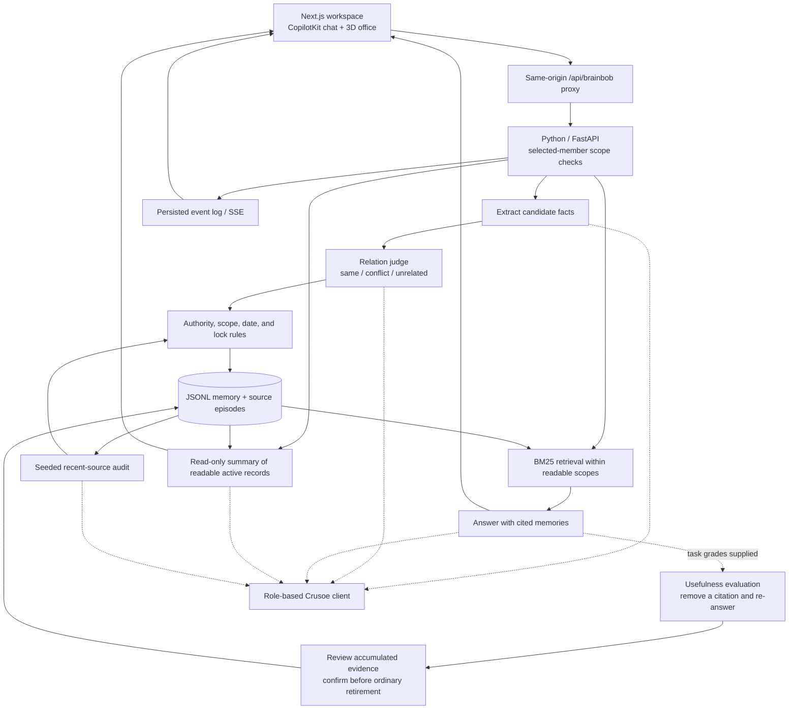

# BrainBob architecture

This describes the implemented October 17 hackathon build. The [initial architecture proposal](architecture-plan-20261017.md) is retained as history; the main app still uses direct Python/Crusoe inference. An optional NemoClaw/OpenClaw adapter is implemented, but sandbox integration and end-to-end validation remain pending. Switchyard, SQL storage, and planner alignment are not integrated.

## Component flow

The browser renders backend outcomes. An animation completing does not authorize a write. Retrace reconstructs recorded history without changing memory or repeating model calls.

## Write, read, and evaluate

**Write-time maintenance.** [`maintain.py`](../backend/brainbob/maintain.py) wraps fact extraction and compares candidates with readable active memories. The relation judge supplies a semantic label; code decides the mutation. Duplicate facts are rejected when the existing record covers the candidate's audience and authority. Approved corrections must satisfy date, approval, scope, and lock rules. Unresolved or unparseable comparisons preserve the existing memory and make the candidate tentative. Missing evidence alone does not justify retirement.

**Scoped retrieval.** [`memory.py`](../backend/brainbob/memory.py) ranks eligible records with BM25; [`acl.py`](../backend/brainbob/acl.py) defines member access and approval rights. The HTTP service checks identity and scope on memory, source, history, write, and event routes. Answers receive a bounded set of records and return cited memory IDs. Retired records are excluded from ordinary retrieval; tentative records are represented separately in the app and may be included by retrieval policies. Access tests cover the development identity contract, not authenticated multi-user deployment.

**Memory summary.** [`summary.py`](../backend/brainbob/summary.py) produces the full-screen Memory panel overview using a dedicated Nano role. The HTTP endpoint first filters stored records by member access and excludes retired records. This path does not use the answering agent, write memory, or emit operation events. It bounds input, reports coverage, and uses the existing content-based inference cache. Summary is current context; the Memory files tab retains original records and reply snapshots. [Configuration and failure behavior](live-workspace.md#memory-summary-and-files).

**Source-support audit.** [`audit.py`](../backend/brainbob/audit.py) samples recent source episodes with a recorded seed (defaults: 10 of the latest 50), records coverage and verdicts, and routes proposed corrections through maintenance. Sampling can miss decisive evidence. The synthetic Rusty Rod run found no additional answer gain from this audit.

**Task-usefulness evaluation.** [`evaluator.py`](../backend/brainbob/evaluator.py) answers a graded task with retrieved memory, removes each cited memory in turn, and answers again. It records whether the grade changes. Review can promote helpful records or retire harmful ones after confirmation; locked harmful records are flagged. This is a separate path requiring task grades, not an automatic truth check on every chat. The default evidence threshold is three distinct task flips; exploratory benchmark variants use other thresholds and are labeled in the report.

**Independent scoring.** `bobbench/` evaluates organizational memory; `benchmarks/bob/` contains smaller relation and structured diagnostics. These scorers are distinct from the production maintenance judge. The [evaluation report](evaluation-report.md) pins historical runs and corrected scorecards; a documentation update does not rerun or upgrade their inference build.

## Runtime boundaries

| Component | Responsibility | Entry point |
| --- | --- | --- |
| Live workspace | Desk conversations, suggestions, memory inspection, retrace | [`live-brain-workspace.tsx`](../apps/web/src/components/live-brain-workspace.tsx) |
| Chat adapter | Connect CopilotKit/AG-UI interactions to backend answers | [`backend-chat-agent.ts`](../apps/web/src/lib/backend-chat-agent.ts) |
| API client and state | HTTP calls, SSE events, scoped state | [`brain-api.ts`](../apps/web/src/lib/brain-api.ts), [`use-brain-backend.ts`](../apps/web/src/lib/use-brain-backend.ts) |
| Python HTTP service | Ingestion, asks, feedback/review, inspection, corrections, permissions | [`server.py`](../backend/server.py), [API contract](../backend/CONTRACT.md) |
| Memory and sources | JSONL records, statuses, supersession links, retrieval | [`memory.py`](../backend/brainbob/memory.py), [`types.py`](../backend/brainbob/types.py) |
| Memory overview | Summarize permitted active records without memory mutations | [`summary.py`](../backend/brainbob/summary.py), [`memory-summary.tsx`](../apps/web/src/components/memory-summary.tsx) |
| Event persistence | Sequence IDs, stored events, live delivery and replay | [`events.py`](../backend/brainbob/events.py) |
| Inference | Role settings, provider calls, cache, retries, usage | [`llm.py`](../backend/brainbob/llm.py) |

Next proxies `/api/brainbob` to the Python server at `127.0.0.1:3001` by default. `BRAINBOB_API_URL` changes the server-side target. `NEXT_PUBLIC_BRAINBOB_API_URL` bypasses the proxy and requires appropriate CORS. The backend key stays in its process environment or private key file. [Connection and offline verification guide](../apps/web/README.md).

## Models and configuration

All normal app inference goes directly to Crusoe through the OpenAI-compatible client. No Switchyard route or NemoClaw harness is involved.

| Role | Live app via `pnpm backend` | Backend / benchmark defaults |
| --- | --- | --- |
| Extraction | `nvidia/NVIDIA-Nemotron-3-Nano-30B-A3B` | `nvidia/Nemotron-3.5-Lightning-30B-A3B` |
| Answering | `nvidia/NVIDIA-Nemotron-3-Super-120B-A12B` | `nvidia/Nemotron-3.5-Lightning-30B-A3B` |
| Memory summarizer | `nvidia/NVIDIA-Nemotron-3-Nano-30B-A3B` | Same; used by the summary endpoint, not benchmark answering |
| Maintenance / source audit | `openai/gpt-oss-120b` | `openai/gpt-oss-120b` |

[`run-live-backend.py`](../scripts/run-live-backend.py) sets application defaults, verifies provider access, and starts the service with isolated persistent data. Environment overrides still apply. Historical experiments use the settings recorded for their own builds, not necessarily these application settings.

The Qwen3-0.6B LoRA relation checker is an opt-in experiment, not the default. Its pair-label gain does not establish safe destructive maintenance. Published confirmation/observe modes and controlled replay evidence are described in the [model handoff](finetune-handoff.md) and [evaluation report](evaluation-report.md); saved-response tests are not fresh-provider safety measurements.

## Optional NemoClaw/OpenClaw adapter

[PR #13](https://github.com/jerelvelarde/BrainBob/pull/13) adds the isolated [adapter and runbook](../integrations/nemoclaw/README.md). The MCP stdio server exposes `read_memory`, `read_source`, and `propose_memory`. The host binds the member; undeclared identity/scope/authority fields are rejected, proposals use discussion authority, and denied source requests do not retry with a broader identity.

Ten fake-transport adapter tests pass. Runtime version pins, MCP registration, effective egress policy, host-managed Crusoe inference, and the real fresh-agent smoke story remain unverified. This adapter does not power the verified browser workspace; its read calls do not fabricate browser retrieval events. [Integration evidence and limits](../judging/nemoclaw-alignment-20261017/README.md).

## Persistence and history

The launcher stores memory, episodes, events, and import receipts under ignored `data/workspace/`. The company importer checks persisted receipts and source contents to skip prior imports; it does not reset the store. The fictional dataset contains 29 conversations spanning 18 members and 22 scopes.

Records carry source, writer, model, scope, authority, status, and correction relationships. State changes persist through JSONL files; this is not a SQL transaction system. Retired records remain inspectable. The event stream drives the live scene and reconstructs historical views.

Each browser desk retains its own conversation context and returned session file in browser-local state. These are not durable server sessions. Follow-ups include a bounded history from that desk, excluding other desks and feedback gold. Reload clears the conversations while server memory and events persist.

## Verified behavior and limits

The [live-workspace record](../judging/live-workspace-20261017/README.md) documents real Crusoe answers, source ingestion, an authorized November 13 correction, scoped reads/writes, source inspection, and read-only replay. Its selected examples are development evidence. Offline proxy tests use deterministic model substitutes and establish integration behavior rather than model quality.

The member header is a development identity selector, not authentication. Do not treat this local app as an authenticated public service. JSONL persistence lacks SQL transaction guarantees; retirement does not erase history. Existing-session revocation, complete export/cache surfaces, uncertainty handling, and general privacy guarantees are not established by the pilot. Full authorized history remains the strongest condition in the small organizational worlds.

The [evaluation report](evaluation-report.md) is the source for measured outcomes. The [historical backend design](backend-design.md) records earlier decisions; the [initial architecture proposal](architecture-plan-20261017.md) records future ideas rather than current behavior.
