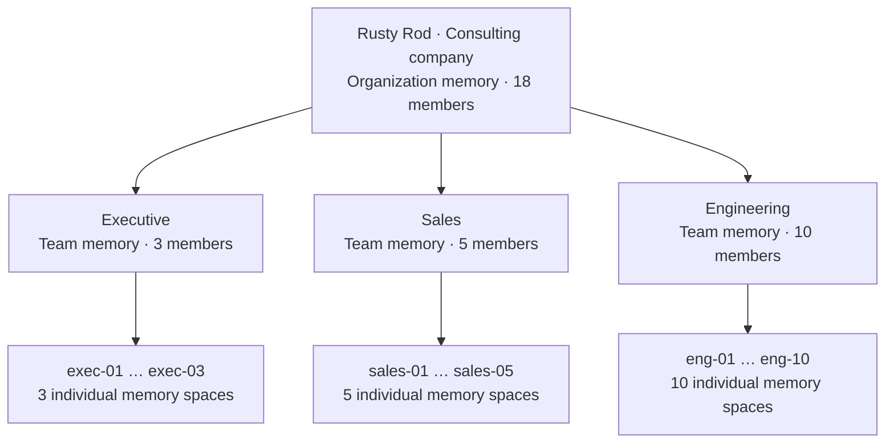
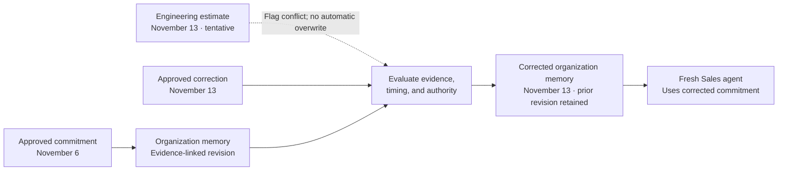

# Sample Company: Rusty Rod

**Rusty Rod** is the fictional consulting company used to explain BrainBob's shared-memory demo. It has **18 individuals across three teams**. Names and reference memories are implemented as synthetic frontend fixtures. Accounts and server permissions are not established by the preview.

The central question is **memory correctness**: when project facts change, can the company correct its shared knowledge before another agent repeats an outdated answer?

## Organization and Teams

The arrows show membership and scope structure, not permission to read every descendant's memory.

| Team | Members | Demo member IDs | Example team knowledge |
| --- | --- | --- | --- |
| Executive | 3 | `exec-01` through `exec-03` | Company strategy, approved commitments, and policy decisions. |
| Sales | 5 | `sales-01` through `sales-05` | Client requirements, proposal context, and commercial assumptions. |
| Engineering | 10 | `eng-01` through `eng-10` | Technical decisions, delivery estimates, and implementation constraints. |
| **Total** | **18** | One team per individual for this demo. | |

People are the demo users; agents work on their behalf and must use the permissions of the represented user. All names below are synthetic. Stable IDs and scope paths remain unchanged when display names change.

| Team | ID | Synthetic name |
| --- | --- | --- |
| Executive | `exec-01` | Mara Ellis |
| Executive | `exec-02` | Theo Bennett |
| Executive | `exec-03` | Nadia Chen |
| Sales | `sales-01` | Maya Flores |
| Sales | `sales-02` | Leo Park |
| Sales | `sales-03` | Priya Shah |
| Sales | `sales-04` | Oscar Reed |
| Sales | `sales-05` | Zoe Brooks |
| Engineering | `eng-01` | Iris Tan |
| Engineering | `eng-02` | Owen Patel |
| Engineering | `eng-03` | Ada Morgan |
| Engineering | `eng-04` | Finn Rivera |
| Engineering | `eng-05` | Nora Kim |
| Engineering | `eng-06` | Eli Cooper |
| Engineering | `eng-07` | Lena Ortiz |
| Engineering | `eng-08` | Kai Thompson |
| Engineering | `eng-09` | Ruby Singh |
| Engineering | `eng-10` | Sam Walker |

## Client Organization: Atlas Harbor

**Atlas Harbor** is a fictional logistics company and Rusty Rod’s client for the Atlas pilot. The pilot reduces the work of preparing client reports. Mara Ellis publishes the approved commitment; Iris Tan’s Engineering estimate remains tentative until an authorized correction.

Atlas Harbor is a separate organization, identified as `atlas-harbor`, not a child scope of `rusty-rod`. A client relationship grants no automatic access to either organization’s private memories. The demo includes a published client brief inside Rusty Rod organization memory. No Atlas Harbor users or internal memory store are seeded; the 22-scope count still describes Rusty Rod alone.

## Cabinets and Session Files

The three cabinets represent **Individual, Team, and Organization**. Drawers separate the members, teams, and organizations within those tiers:

- Individual: one drawer per person; only the represented member’s drawer is accessible.
- Team: Executive, Sales, and Engineering drawers; only their own team is accessible.
- Organization: Rusty Rod and its client Atlas Harbor; Rusty Rod members read Rusty Rod’s shared memory. The client’s private drawer remains closed.

A Sales member can read all their individual memory, all Sales memory, and all shared Rusty Rod memory, but no Executive memory or other person’s private records. A session file then selects relevant, accessible context from those three tiers for the task. The 3D Individual cabinet previews three named drawers; its inspector lists all 18 people.

Cabinets organize memory; session files combine it. See [session-files.md](session-files.md) for assembly, evidence, export, and backend requirements.

## Memory Scopes

The demo has **22 logical memory spaces**: one organization space, three team spaces, and 18 individual spaces. These are access scopes, not a requirement for separate databases.

| Scope | Example scope path | Intended readers | Example memory |
| --- | --- | --- | --- |
| Organization | `rusty-rod` | All 18 authenticated organization members. | An approved client delivery commitment. |
| Executive team | `rusty-rod/executive` | The 3 Executive members. | A strategy discussion awaiting approval. |
| Sales team | `rusty-rod/sales` | The 5 Sales members. | Draft proposal assumptions. |
| Engineering team | `rusty-rod/engineering` | The 10 Engineering members. | A technical estimate awaiting validation. |
| Individual | `rusty-rod/sales/sales-01` | That individual and agents explicitly acting on their behalf. | Personal working notes or communication preferences. |

For example, an agent acting for Maya Flores (`sales-01`) should read organization memory, Sales team memory, and that user's individual memory. It should not receive Engineering team memory or another salesperson's private notes.

Executive membership does not automatically grant access to other teams or individuals. Cross-team sharing requires an authorized publication to organization memory or an explicit grant. Reading a scope does not imply permission to write, approve, or delete its records. This is the intended demo policy, not a claim of production authentication or authorization enforcement.

The scope paths follow the backend's documented hierarchy convention; see the [backend contract](../backend/CONTRACT.md) for the current interface and the [architecture](architecture.md) for the intended permission model.

## Correctness Scenario: A Changed Client Commitment

The following facts and dates are synthetic demo fixtures, not real client commitments or measured results.

1. **Establish a supported fact.** An authorized organization record states that the Atlas client pilot is due November 6, 2026, with a link to its approval conversation.
2. **Introduce conflicting evidence.** Engineering discusses November 13 as a revised estimate. A tentative team estimate alone must not silently overwrite the approved organization commitment.
3. **Approve a correction.** A later authorized organization conversation explicitly changes the commitment to November 13. The evaluator checks the source, its timing, and authority before proposing a new revision.
4. **Reuse the corrected memory.** A fresh agent acting for a Sales member drafts a client update from organization memory. It should use November 13 and cite the current revision without reading private Engineering discussions.
5. **Preserve valid knowledge.** The client's unchanged project goals remain active. Missing evidence in a random sample must not cause those memories to be forgotten.
6. **Retrace the decision.** Inspect the original evidence, conflicting estimate, approved correction, memory revision, and subsequent retrieval, filtered to the viewer's permissions.

Recent-conversation sampling can miss the correction. Report whether the decisive evidence was available, whether the evaluator judged it correctly, and whether the subsequent answer used the correct fact. A selected demo trace is not an evaluation score.

## What to Demonstrate

- Correct updates after explicit, authorized corrections; no overwrite from tentative or older evidence.
- Preservation of valid memories and visible uncertainty when evidence is insufficient.
- A fresh agent using the corrected fact, compared with an append-only baseline.
- Denied cross-team and cross-individual reads, including evidence, history, and retrace exports.
- A retrace connecting each decision to its source and exact memory revision.

Use the [benchmark plan](benchmarks.md) for measurement and record actual outcomes in the [judging evidence sheet](../judging/evidence.md).
