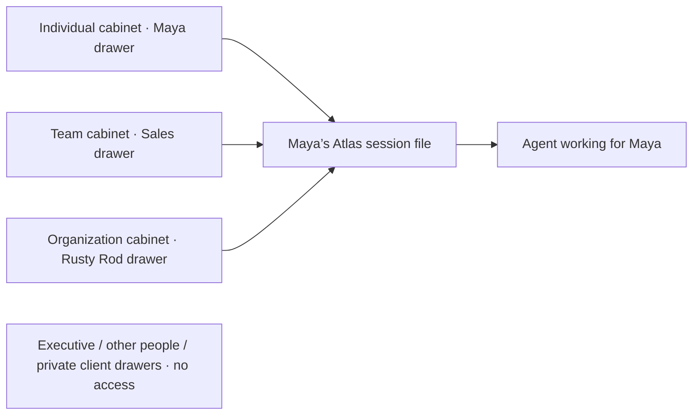

# Tier cabinets and agent session files

The room has **Individual, Team, and Organization cabinets**. Each drawer is a person, team, or organization. For a Sales member, the accessible drawers are their own, Sales, and Rusty Rod. Executive and other members’ individual drawers stay closed. Atlas Harbor is a fictional logistics client, not an inherited permission scope.

A **session file** combines the relevant, accessible memory needed for a specific agent task. Access covers all records in the three permitted scopes; relevance determines which current records enter this particular file. It is a derived snapshot, not a new permission scope or a replacement for canonical memory.

## The demo file

At `/demo`, select **Maya Flores**, open **Session file**, and download `sales-01-atlas-session.md`. Each desk has a seated Bob with its own file. Clicking a table, Bob, or nameplate opens that desk’s full-screen personal chat; clicking its folder or label opens the chat with its file inspector. Clicking a cabinet opens the selected person’s tier inspector with accessible and closed drawers; its session-file button opens their assembled file. Maya’s file contains:

- Individual: Maya’s preference for a concise, three-sentence client update.
- Team: Sales guidance to cite the approved commitment and preserve the reporting goal.
- Organization: the current Atlas delivery date, unchanged reporting goal, and the published Atlas Harbor client brief.
- Evidence: source IDs, source text, author IDs, timestamps, authority labels, and exact record revisions.

After the approved correction, November 13 replaces the retired November 6 record in the file. The earlier revision stays in the separate evidence/history view. Switching to Leo Park uses his own preference. Switching to Iris Tan adds relevant Engineering context, explicitly marking estimates as tentative and unknown dependencies as unresolved.

The unrelated bicycle-parking policy stays in memory but is excluded from this task. Other people’s private notes, other teams’ sources, and private Atlas Harbor records are excluded. A record whose source is unavailable or inaccessible is not included; a missing-evidence count marks the file as incomplete. That exclusion does not delete or retire anything.

The client brief is published into Rusty Rod organization memory. Atlas Harbor is not an ancestor or descendant of Rusty Rod; the relationship itself grants no private-data access. There remain 22 internal Rusty Rod scopes.

## Assembly contract

1. Identify the represented member, task, and memory snapshot. Authenticate this identity on the server for live operation.
2. Enforce access before relevance selection, including access to evidence. A drawer label must not reveal another member’s individual records or files.
3. Select current records relevant to the task; preserve tentative and unresolved information as labeled context. Do not treat them as approved facts.
4. Attach the exact IDs/revisions and accessible evidence. Report missing required evidence or insufficient task context rather than asserting completeness.
5. Freeze the selected context as the session’s input. Later corrections can produce a new file; retracing an earlier session must retain its earlier snapshot.
6. Let the agent read that file before working. Proposed updates afterward go through the existing write/correct/evaluate flow with their original scope and authority checks; editing the assembled file does not authorize a canonical write.

## Current implementation and handoff

The frontend assembler is deterministic and uses authored `atlas-update` relevance tags. Its Markdown download is real, but the scenario and sources are synthetic. It does not call a relevance model, establish context completeness for arbitrary tasks, or run Crusoe inference. All fixture data ships in the browser; client filtering is a presentation preview, not an access boundary.

Both routes have three desk sessions: Iris on the left, Maya in the center, and Mara on the right. Each seated Bob faces the initial camera direction; each screen and keyboard points toward its operator. Click a desk/Bob to resume its chat or its folder to inspect that session’s file. The account popup also has keyboard-accessible desk shortcuts. Switching desks preserves each conversation; New session or choosing a replacement person resets only the selected desk. A walkthrough step change still refreshes the scripted files and conversations for that step.

On the main HTTP/SSE route, each desk’s current chat is its session boundary: Ask drives Working, Answer ready, Failed, or Stopped state independently. Remember, Usefulness, and Review do not replace its answer file. Bob writes while an Ask is in flight; pause and reduced motion freeze the gesture. Only the selected desk renders the canvas and subscribes to SSE; its saved event cursor resumes on return. Other desk agents retain their chat/request state, and late completions from a replaced desk revision are ignored.

The table opens a full-screen CopilotKit conversation with a personal greeting and three memory-based starter prompts, one per tier. Suggestions use accessible current records; retired and flagged records are excluded, while tentative context is labeled as an open question. With no loaded records, the prompts ask to discover context instead of inventing facts. Closing the chat preserves its conversation; changing members clears it. The file opens beside the conversation on desktop and covers it on mobile. The `/demo` chat returns explicitly scripted context previews with no inference; the main route retains backend requests.

After Ask completes, that desk’s file snapshots the returned task ID, question, answer, cited IDs, and accessible records from `/ask.memories`, grouped by Individual, Team, and Organization. It can be downloaded as JSON. Subsequent SSE changes do not rewrite this snapshot; the next Ask starts a new file at the same desk. Before Ask, or after failure/cancellation, the UI does not invent a completed file. This is the desk’s current chat file, not a historical file reconstructed by event retrace.

**Server-side session-file assembly, persistence, and full model-input tracing remain unimplemented.** Returned retrieval records do not establish the exact prompt or complete context supplied to the model. Source/history links open the current record inspector; source bodies are not embedded in the live file. The three desks are browser-local sessions, not a global registry or evidence of three concurrent inference jobs. Reloading clears these local conversations and files.

Bonan’s backend handoff should provide a session/task ID, represented member, selected memory IDs/revisions, accessible source references, relevance/omission metadata, snapshot/event sequence, actual model attribution, and cost where available. Keep factual correctness, leave-one-out usefulness, and retrieval relevance distinct. Do not add a wire event until both sides agree its contract. Backend and bench remain Bonan’s files.
