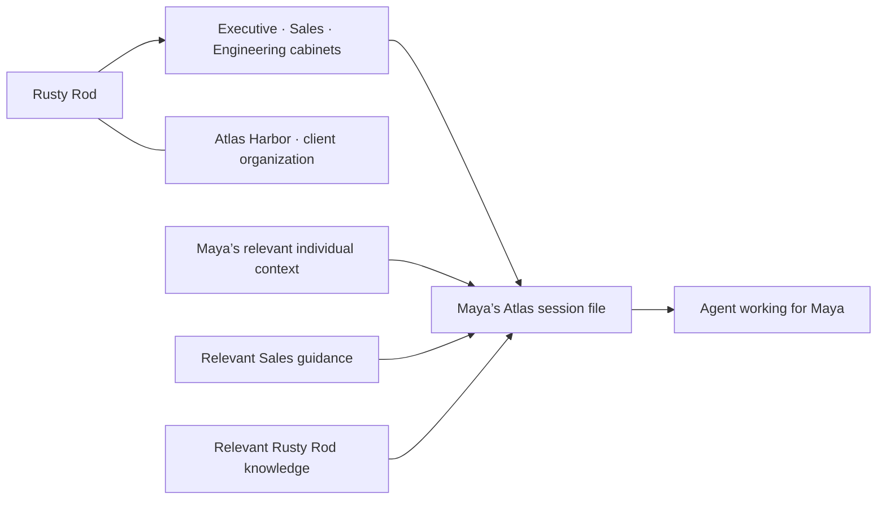

# Team cabinets and agent session files

Rusty Rod is the organization. Executive, Sales, and Engineering each have a cabinet. Atlas Harbor is a fictional client organization. The roster and stable member IDs are in [sample-company.md](sample-company.md).

**One file is the context for one agent session**, acting for a particular member on a particular task at a particular memory revision. It combines relevant individual, team, and organization records. A file is a derived snapshot, not a new permission scope or a replacement for the canonical memory store.

## The demo file

At `/demo`, select **Maya Flores**, open **Session file**, and download `sales-01-atlas-session.md`. The visible desk folder and her Sales cabinet open the same panel. The file contains:

- Individual: Maya’s preference for a concise, three-sentence client update.
- Team: Sales guidance to cite the approved commitment and preserve the reporting goal.
- Organization: the current Atlas delivery date, unchanged reporting goal, and the published Atlas Harbor client brief.
- Evidence: source IDs, source text, author IDs, timestamps, authority labels, and exact record revisions.

After the approved correction, November 13 replaces the retired November 6 record in the file. The earlier revision stays in the separate evidence/history view. Switching to Leo Park uses his own preference. Switching to Iris Tan adds relevant Engineering context, explicitly marking estimates as tentative and unknown dependencies as unresolved.

The unrelated bicycle-parking policy stays in memory but is excluded from this task. Other people’s private notes, other teams’ sources, and private Atlas Harbor records are excluded. A record whose source is unavailable or inaccessible is not included; a missing-evidence count marks the file as incomplete. That exclusion does not delete or retire anything.

The client brief is published into Rusty Rod organization memory. Atlas Harbor is not an ancestor or descendant of Rusty Rod; the relationship itself grants no private-data access. There remain 22 internal Rusty Rod scopes.

## Assembly contract

1. Identify the represented member, task, and memory snapshot. Authenticate this identity on the server for live operation.
2. Enforce access before relevance selection, including access to evidence. A cabinet’s team membership must not reveal another member’s individual records or files.
3. Select current records relevant to the task; preserve tentative and unresolved information as labeled context. Do not treat them as approved facts.
4. Attach the exact IDs/revisions and accessible evidence. Report missing required evidence or insufficient task context rather than asserting completeness.
5. Freeze the selected context as the session’s input. Later corrections can produce a new file; retracing an earlier session must retain its earlier snapshot.
6. Let the agent read that file before working. Proposed updates afterward go through the existing write/correct/evaluate flow with their original scope and authority checks; editing the assembled file does not authorize a canonical write.

## Current implementation and handoff

The frontend assembler is deterministic and uses authored `atlas-update` relevance tags. Its Markdown download is real, but the scenario and sources are synthetic. It does not call a relevance model, establish context completeness for arbitrary tasks, or run Crusoe inference. All fixture data ships in the browser; client filtering is a presentation preview, not an access boundary.

The main HTTP/SSE route shares the team-cabinet scene and names. It still uses the existing backend retrieval/answer contract; **live session-file assembly and storage are not implemented**. The folder visualization must not be described as proof of the model’s actual input.

Bonan’s backend handoff should provide a session/task ID, represented member, selected memory IDs/revisions, accessible source references, relevance/omission metadata, snapshot/event sequence, actual model attribution, and cost where available. Keep factual correctness, leave-one-out usefulness, and retrieval relevance distinct. Do not add a wire event until both sides agree its contract. Backend and bench remain Bonan’s files.
