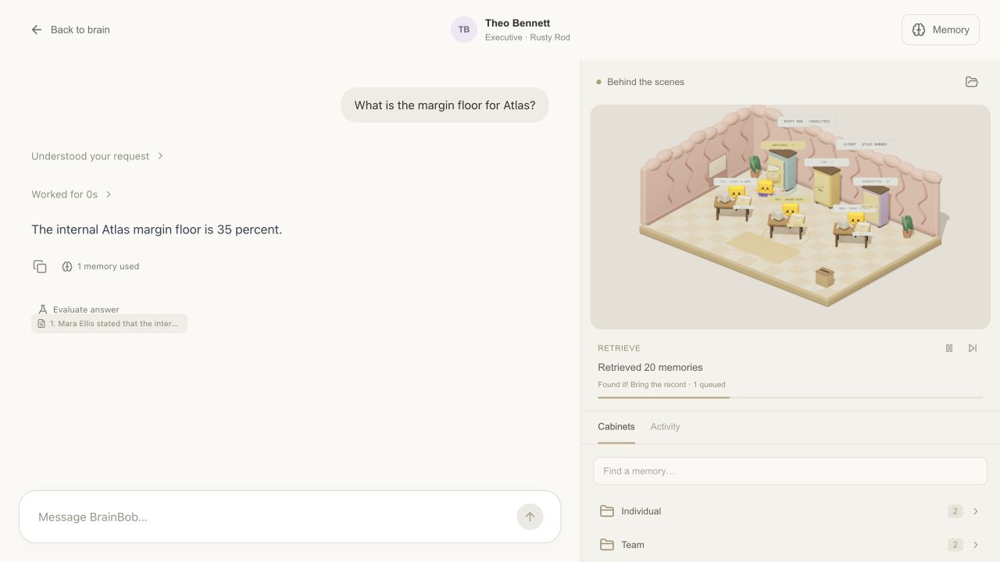

# Shared correction through chat

Implementation `a1146b422a72acdbb2e48cd65383c4696d87da9e` (2026-10-17T18:21:44-07:00); local, not pushed.

The conversation router only offered save/retire, so “update that to 35%” became a new personal preference. The real backend had a tentative private copy m82 while the shared Executive record m22 still said 28%. Theo correctly could not read Mara’s private copy.

The new correct action identifies the existing record and an exact unique substring. The frontend re-reads permitted memories, replaces that substring while retaining unrelated clauses, and calls the existing permission-checked `/memories/{id}/correct` endpoint. It checks the returned supersedes relationship and original scope, clears stale answering context, and displays the actual correction receipt. Locked, inaccessible, retired and denied targets do not fall back to private saves. No backend source was changed.

Live browser verification: Mara’s “update that to 35%” revised the team record to m83 and retired m22. Theo then answered 35%, citing m83. The Executive-only confidentiality clause remained intact. API reads confirmed Mara and Theo can read m83, Sales cannot, and Theo cannot read Mara’s personal m82. The existing backend returned the correction as trial/discussion; this is not a claim of promotion or approval. The tentative private record was preserved.

The two new regression cases failed before implementation. Afterward, 86 tests in 11 files and TypeScript passed. Screenshot captured at 2026-10-17T18:22:00.154-07:00 after committing the implementation, with unrelated README, film and prior proof edits present but excluded.

[Real events, plan comparison and permission checks](verification.json).

## Publication validation

The same fix was cherry-picked onto latest `origin/main` as `053412a8a97b926cab573b87f22217a70a7563c5` for the bug-fix PR. TypeScript and 83 tests in 10 files pass on this branch. The earlier screenshot and 86-test local run include the separate answer-evaluation UI, which is excluded from this PR. The original local implementation and capture timestamps above remain historical evidence.
